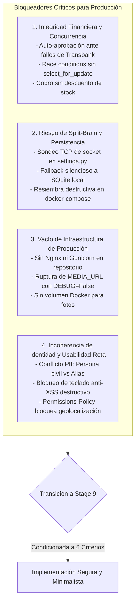

# Intermediate Zoom Out Review (Stage 8): Architectural Health, Simplicity & Viability Audit

**Documento Auditado**: [`DOCUMENTACION_SISTEMA.md`](file:///home/misnull/Proyectos/inacap-ecommerce/DOCUMENTACION_SISTEMA.md)  
**Contexto Auditado**:
- Stage 5: [`zoom_out_report.md`](file:///root/.gemini/antigravity-cli/brain/3bfe860b-3fd4-41f9-855b-0ded13b04084/zoom_out_report.md)
- Stage 6: [`comprehension_report.md`](file:///root/.gemini/antigravity-cli/brain/3bfe860b-3fd4-41f9-855b-0ded13b04084/comprehension_report.md)
- Stage 7: [`critic_report.md`](file:///root/.gemini/antigravity-cli/brain/3bfe860b-3fd4-41f9-855b-0ded13b04084/critic_report.md)  
**Revisor Especializado**: `egm-zoom-out` (Arquitecto Escéptico: Simplicidad, YAGNI y Viabilidad).

---

## 1. Evaluación de Salud Arquitectónica y Cohesión

### 1.1. Diagnóstico del Sistema: La Paradoja de la Doble Realidad
La arquitectura de **Tienda Vecina** presenta una disociación entre sus especificaciones declaradas y la realidad de su base de código:
- **En el papel (Modelo Ideal)**: Se describe como un sistema de nivel empresarial alineado con ISO/IEC 27001:2022 y OWASP ASVS, arquitectura desacoplada Vue 3 SPA + Django 6 REST, pasarela Transbank Webpay Plus oficial y transacciones ACID inviolables sobre PostgreSQL 16.
- **En el código (Prototipo Académico / Mockup)**: Conserva atajos frágiles que constituyen riesgos críticos para producción:
  1. Sondeo TCP de socket en `settings.py` que degrada silenciosamente a SQLite local (riesgo severo de *split-brain* bajo múltiples workers Gunicorn).
  2. Fallback de pago en `services.py` que captura excepciones bancarias y auto-aprueba órdenes con códigos falsos.
  3. Bloqueo reactivo de teclado (`@keypress`) y listas negras de caracteres (`$`, `*`, `[`, `]`, `;`), que rompen descripciones técnicas comerciales legítimas tratando de resolver un problema que Vue 3 resuelve nativamente en el DOM.
  4. Inexistencia de Nginx y Gunicorn en el repositorio, provocando que con `DEBUG=False` todas las imágenes de productos devuelvan error `HTTP 404`.

### 1.2. Dictamen de Viabilidad
El stack tecnológico de base (**Vue 3 + Vite + Tailwind**, **Django 6 + DRF**, **PostgreSQL 16**) es sólido y estándar. Sin embargo, **el sistema NO es viable para producción en su estado actual** debido a la presencia de atajos de desarrollo demo que actúan como trampas financieras y operacionales.

---

## 2. Síntesis de Vulnerabilidades Arquitectónicas Críticas

Se identifican cuatro clústeres bloqueadores fundamentales:

---

## 3. Presupuesto de Complejidad y Evaluación de Riesgos (Anti-Mitigation Bloat)

Para evitar inflar la arquitectura con dependencias innecesarias (YAGNI), se evalúa cada propuesta de remediación contra el presupuesto de simplicidad:

| Área de Remediación | Trampa de Sobreingeniería (Evitar) | Solución Minimalista Escéptica (Adoptar) | Impacto de Complejidad |
| :--- | :--- | :--- | :--- |
| **Procesamiento de Imágenes** | Introducir Celery + Redis + Flower para encolar el procesamiento de imágenes. | **Pre-escalado en Canvas HTML5 (Frontend) + Pillow en un solo paso (Backend)** sin iteraciones de compresión. | **-80% Complejidad**: Cero infraestructura de colas añadida. |
| **Pagos y Reversas** | Diseñar un orquestador de microservicios o patrón Saga complejo. | **Fail-Closed estricto + `@transaction.atomic` + `select_for_update` + Reversa síncrona en fallo**. | **ACID Estándar**: Reutiliza capacidades nativas del ORM Django. |
| **Resiliencia de Base de Datos** | Añadir routers dinámicos de base de datos o reconexión en caliente. | **Fail-Fast**: Eliminar el sondeo de socket y el fallback a SQLite. Si PostgreSQL no responde, el proceso aborta y Docker gestiona el reinicio. | **Elimina Split-Brain**: Elimina más de 40 líneas de red frágil en `settings.py`. |
| **Prevención XSS** | Parsers de expresiones regulares complejos en teclado. | **Confianza en el Framework**: Eliminar intercepción física de teclado y listas negras. Usar interpolación estándar de Vue 3 (`{{ }}`), saneamiento HTML y cabeceras CSP. | **Restaura Usabilidad**: Cero sobrecarga de validación personalizada. |
| **Identidad y Roles** | Reescribir el modelo en árboles dinámicos de permisos u OAuth2. | **Consolidación en `UserCredential.role`**: Mantener las 3 capas para cumplir los requerimientos docentes, pero usar `UserCredential.role` como fuente de verdad canónica. | **Cero Shock de Migración**: Estabiliza modelos sin joins redundantes. |
| **Infraestructura Web** | Orquestaciones complejas en Kubernetes o Traefik con service meshes. | **Contenedor Nginx Minimalista**: Un `nginx.conf` conciso que sirva `dist/`, `/media/` y enrute `/api/` hacia Gunicorn. | **Línea Base Productiva**: 1 contenedor ligero añadido a `docker-compose.yml`. |

---

## 4. Criterios de Decisión Go / No-Go para la Etapa 9

Para asegurar que la Etapa 9 (Implementation Readiness Test) trabaje sobre especificaciones estables, se fijan **6 Compuertas Go/No-Go Incondicionales**:

1. **[GATE 1: PAGOS FAIL-CLOSED]**: Eliminar la auto-aprobación en excepciones bancarias; todo fallo debe marcar la orden como `FAILED`. Eliminar el modal simulador e implementar el flujo de redirección oficial Webpay.
2. **[GATE 2: ELIMINACIÓN DE SPLIT-BRAIN Y FAIL-FAST]**: Suprimir el sondeo de socket y el fallback a SQLite en `settings.py`. Retirar `seed_ecommerce` del comando de inicio de Docker.
3. **[GATE 3: CONCURRENCIA E INTEGRIDAD DE STOCK]**: Forzar `@transaction.atomic` y `select_for_update()` en la confirmación de pago; disparar reversa automática en Transbank ante falta de inventario.
4. **[GATE 4: INFRAESTRUCTURA Y MEDIOS PERSISTENTES]**: Incorporar configuración de Nginx y Gunicorn en `docker-compose.yml` con volumen nombrado persistente para `/media/productos/`.
5. **[GATE 5: USABILIDAD COMERCIAL RESTAURADA]**: Eliminar `@keypress` destructivo y permitir caracteres comerciales (`$`, `*`, `[`, `]`, `;`).
6. **[GATE 6: RESOLUCIÓN DE CONTRADICCIONES DE IDENTIDAD Y ENLACES]**: Exponer únicamente `UserProfile.public_alias` en el catálogo general, ajustar `Permissions-Policy` y reemplazar enlaces absolutos de Windows (`file:///C:/...`) por rutas relativas.
