# Auditoría Exhaustiva de Seguridad Backend — Tienda Vecina (inacap-ecommerce)
**Rama Auditada:** `develop`  
**Entorno de Referencia:** Django 5.x / Python 3.14 / PostgreSQL / DRF  
**Norma de Cumplimiento:** ISO/IEC 27001 & OWASP API Security Top 10 (2023)  
**Fecha de Emisión:** Noviembre 2026  

---

## Índice General
1. [Resumen Ejecutivo y Matriz de Hallazgos](#1-resumen-ejecutivo-y-matriz-de-hallazgos)
2. [Módulo 1: `backend/apps/payments/` (Pagos, Transbank y Carrito)](#2-módulo-1-backendappspayments)
3. [Módulo 2: `backend/apps/accounts/` (Autenticación, JWT y RBAC)](#3-módulo-2-backendappsaccounts)
4. [Módulo 3: `backend/apps/products/` (Catálogo, Imágenes y Reseñas)](#4-módulo-3-backendappsproducts)
5. [Módulo 4: `backend/apps/security/` (Middlewares y Auditoría)](#5-módulo-4-backendappssecurity)
6. [Módulo 5: `backend/config/` (Configuración, Base de Datos y Secretos)](#6-módulo-5-backendconfig)
7. [Plan de Remediación Priorizado](#7-plan-de-remediación-priorizado)

---

## 1. Resumen Ejecutivo y Matriz de Hallazgos

Se ha ejecutado una auditoría de seguridad exhaustiva, estática y dinámica, línea por línea sobre el código fuente de los 5 módulos troncales del backend de Tienda Vecina en la rama `develop`.

El análisis detectó **16 vulnerabilidades y debilidades arquitectónicas confirmadas**, distribuidas en la siguiente escala de severidad:
- **1 Hallazgo Crítico (Critical)**
- **2 Hallazgos Altos (High)**
- **6 Hallazgos Medios (Medium)**
- **7 Hallazgos Bajos (Low)**

### Matriz de Hallazgos

| ID | Severidad | Módulo | Título de la Vulnerabilidad | CWE / OWASP |
|---|:---:|---|---|---|
| **FINDING-01** | **CRITICAL** | `apps/payments` | Bypass Incondicional de Autorización y Pago Fraudulento en Transbank Webpay Plus | CWE-287 / API2:2023 |
| **FINDING-02** | **HIGH** | `apps/payments` | Falta de Idempotencia y Ataque de Repetición (Replay) para Vaciado de Inventario | CWE-799 / API4:2023 |
| **FINDING-03** | **HIGH** | `apps/payments` | Condición de Carrera en Descuento de Stock y Ausencia de Bloqueo Transaccional | CWE-362 / API8:2023 |
| **FINDING-04** | **MEDIUM** | `apps/accounts` | Degradación Involuntaria de Privilegios Administrativos vía Endpoint de Ascenso | CWE-269 / API5:2023 |
| **FINDING-05** | **MEDIUM** | `apps/accounts` | Desincronización y Retención Indebida de Privilegios RBAC (`UserRol`) | CWE-653 / API5:2023 |
| **FINDING-06** | **MEDIUM** | `apps/products` | Agotamiento de Recursos y DoS en Catálogo Público No Paginado | CWE-400 / API4:2023 |
| **FINDING-07** | **MEDIUM** | `apps/products` | Manipulación de Reputación y Reseñas Fraudulentas sin Verificación de Compra | CWE-840 / API10:2023 |
| **FINDING-08** | **MEDIUM** | `config` | Conmutación Silenciosa a SQLite Local y Riesgo de Split-Brain / Pérdida de Datos | CWE-1188 / API8:2023 |
| **FINDING-09** | **MEDIUM** | `config` / `accounts` | Ausencia de Rate Limiting (Throttling) en Endpoints Críticos de Autenticación | CWE-307 / API4:2023 |
| **FINDING-10** | **LOW** | `apps/security` | Inyección de Registros (CRLF Log Injection) y Spoofing en Auditoría ISO 27001 | CWE-117 / API8:2023 |
| **FINDING-11** | **LOW** | `apps/accounts` | Autoasignación Inmediata de Insignia de Tienda Oficial sin Moderación Administrativa | CWE-284 / API5:2023 |
| **FINDING-12** | **LOW** | `apps/accounts` | Excepción `IntegrityError` No Manejada en Registro y Fuga de Información por RUT | CWE-209 / API8:2023 |
| **FINDING-13** | **LOW** | `apps/payments` | Excepción `ValueError` / `TypeError` No Controlada en Cálculo de Carrito (DoS) | CWE-20 / API8:2023 |
| **FINDING-14** | **LOW** | `apps/products` | Esquema de Galería No Validado en `existing_images` (Inyección en JSONField) | CWE-20 / API8:2023 |
| **FINDING-15** | **LOW** | `apps/accounts` | Omisión de Verificación de Cuenta Bloqueada (`is_locked`) en Autenticación JWT | CWE-307 / API2:2023 |
| **FINDING-16** | **LOW** | `apps/security` | Política de `connect-src` Permisiva en CSP (Comodín en Localhost) | CWE-16 / API8:2023 |

---

## 2. Módulo 1: `backend/apps/payments/`

### FINDING-01: Bypass Incondicional de Autorización y Pago Fraudulento en Transbank Webpay Plus
- **Categoría:** Broken Authentication & Authorization Bypass (CWE-287 / OWASP API2:2023)
- **Archivo y Líneas:** `backend/apps/payments/services.py:119-147` y `backend/apps/payments/views.py:138-154`
- **Flujo de Entrada hasta el Sumidero (Source-to-Sink):**
  1. `[Source]` El cliente inicia una compra en `TransbankInitAPIView.post` (`backend/apps/payments/views.py:56`) y obtiene un token de transacción.
  2. Sin ingresar tarjeta o tras ser rechazada por el banco emisor (o abortada por el usuario), el atacante invoca `POST /api/v1/payments/transbank/commit/` con el token.
  3. En `TransbankWebpayService.commit_transaction` (`backend/apps/payments/services.py:121-147`), si el token comienza con `tbk_token_` o si `tx.commit(token)` levanta cualquier excepción (por ejemplo `transbank.error.TransactionCommitError` o HTTP 401/422), el bloque `except Exception:` captura el fallo, lo imprime en consola y cae de forma incondicional a las líneas 139-147:
     ```python
     return {
         'response_code': 0,
         'authorization_code': f"AUTH_{uuid.uuid4().hex[:6].upper()}",
         'amount': 0,
         'status': 'AUTHORIZED'
     }
     ```
  4. `[Sink]` `TransbankCommitAPIView.post` (`backend/apps/payments/views.py:140-154`) evalúa `if commit_result.get('status') == 'AUTHORIZED':`, actualiza la orden a `status = 'AUTHORIZED'`, descuenta el stock de los productos y emite un voucher legítimo con código de autorización.
- **Invariante de Seguridad Quebrantado:**
  *Ninguna orden de compra debe transicionar al estado `AUTHORIZED` sin que la pasarela financiera externa haya confirmado explícita e inequívocamente la captura exitosa y efectiva de los fondos (`response_code == 0`). Todo error o token no verificado debe ser rechazado inmediatamente.*
- **Impacto y Severidad:** **CRITICAL**. Fraude financiero total. Cualquier usuario puede obtener productos del marketplace gratuitamente enviando la confirmación de una orden no pagada, causando pérdida económica directa y desabastecimiento de inventario.
- **Remediación con Código Corregido:**
  Reescribir `commit_transaction` en `backend/apps/payments/services.py`:
  ```python
  def commit_transaction(self, token: str):
      """Paso 2 Transbank: Confirma la transacción verificando captura bancaria estricta."""
      tx = self.get_tx()
      # En producción o cuando no hay SDK configurado, no permitir aprobación simulada
      if not tx or token.startswith('tbk_token_'):
          if settings.DEBUG:
              # Solo en DEBUG local explícito permitir simulación
              return {
                  'response_code': 0,
                  'authorization_code': f"AUTH_DEV_{uuid.uuid4().hex[:6].upper()}",
                  'amount': 0,
                  'card_number': '6623',
                  'payment_type_code': 'VN',
                  'shares_number': 1,
                  'status': 'AUTHORIZED'
              }
          return {
              'status': 'REJECTED',
              'response_code': -1,
              'error': 'Token de prueba inválido en ambiente productivo.'
          }

      try:
          response = tx.commit(token)
          resp_dict = response if isinstance(response, dict) else response.__dict__
          is_approved = resp_dict.get('response_code') == 0
          return {
              'response_code': resp_dict.get('response_code'),
              'authorization_code': resp_dict.get('authorization_code'),
              'amount': resp_dict.get('amount'),
              'card_number': resp_dict.get('card_detail', {}).get('card_number', '0000'),
              'payment_type_code': resp_dict.get('payment_type_code', 'VN'),
              'shares_number': resp_dict.get('shares_number', 1),
              'status': 'AUTHORIZED' if is_approved else 'REJECTED'
          }
      except Exception as e:
          # Jamás retornar AUTHORIZED ante excepciones
          return {
              'status': 'REJECTED',
              'response_code': -1,
              'error': str(e)
          }
  ```

---

### FINDING-02: Falta de Idempotencia y Ataque de Repetición (Replay) para Vaciado de Inventario
- **Categoría:** Lack of Idempotency / Replay Attack (CWE-799 / OWASP API4:2023)
- **Archivo y Líneas:** `backend/apps/payments/views.py:127-168`
- **Flujo de Entrada hasta el Sumidero (Source-to-Sink):**
  1. `[Source]` El cliente obtiene un token legítimo y realiza el pago de una orden.
  2. Una vez confirmada la orden (estado `AUTHORIZED`), un atacante o cliente automatizado reenvía peticiones `POST /api/v1/payments/transbank/commit/` con el mismo token repetidamente.
  3. `Order.objects.get(transbank_token=token)` (`views.py:133`) recupera la orden sin comprobar si ya se encuentra en estado `AUTHORIZED`.
  4. `[Sink]` El bucle de descuento de inventario (`views.py:149-153`):
     ```python
     for item in order.items.all():
         prod = item.product
         if prod.stock >= item.quantity:
             prod.stock -= item.quantity
             prod.save(update_fields=['stock'])
     ```
     se ejecuta nuevamente en cada llamada, reduciendo el stock del catálogo en múltiplos de la cantidad comprada hasta llegar a 0.
- **Invariante de Seguridad Quebrantado:**
  *El procesamiento de confirmación de pago debe ser estrictamente idempotente. Los productos asociados a una orden de compra deben ser descontados del inventario exactamente una sola vez.*
- **Impacto y Severidad:** **HIGH**. Denegación de servicio comercial. Con una sola compra de bajo costo, un actor malicioso puede agotar artificialmente el stock de múltiples vendedores del marketplace, bloqueando ventas legítimas.
- **Remediación con Código Corregido:**
  Incorporar validación de estado previo y control de idempotencia en `TransbankCommitAPIView`:
  ```python
  if order.status == 'AUTHORIZED':
      # Si ya fue autorizada, retornar el voucher existente de forma idempotente sin alterar stock
      return Response({
          "status": "success",
          "message": "Transacción previamente confirmada y autorizada.",
          "voucher": {
              "buy_order": order.buy_order,
              "authorization_code": order.authorization_code,
              "amount": float(order.total_amount),
              "card_last_digits": order.card_last_digits,
              "payment_type": "Débito / Crédito Webpay Plus",
              "shares_number": order.shares_number,
              "status": "APROBADO",
              "timestamp": order.updated_at.isoformat()
          }
      }, status=status.HTTP_200_OK)
  ```

---

### FINDING-03: Condición de Carrera en Descuento de Stock y Ausencia de Bloqueo Transaccional
- **Categoría:** Concurrency & Race Condition / Time-of-Check to Time-of-Use (CWE-362 / OWASP API8:2023)
- **Archivo y Líneas:** `backend/apps/payments/views.py:149-154`
- **Flujo de Entrada hasta el Sumidero (Source-to-Sink):**
  1. `[Source]` Dos peticiones simultáneas de confirmación (o dos compras concurrentes del último ítem disponible) son procesadas en hilos o procesos WSGI independientes.
  2. Ambos procesos consultan `prod = item.product` y verifican `if prod.stock >= item.quantity:` de manera concurrente. Ambos leen `stock = 1`.
  3. `[Sink]` Ambos procesos restan `1` y ejecutan `prod.save(update_fields=['stock'])` sin bloqueo de fila (`select_for_update`) ni expresión atómica `F('stock') - quantity`.
- **Invariante de Seguridad Quebrantado:**
  *La verificación y deducción de existencias en el inventario debe ejecutarse bajo aislamiento transaccional estricto (ACID) con bloqueo pesimista o expresiones atómicas a nivel de motor de base de datos.*
- **Impacto y Severidad:** **HIGH**. Sobrevents (overselling) e inconsistencia crítica de inventario en periodos de alto tráfico (CyberDay / promociones).
- **Remediación con Código Corregido:**
  En `backend/apps/payments/views.py`:
  ```python
  from django.db import transaction
  from django.db.models import F

  with transaction.atomic():
      order = Order.objects.select_for_update().filter(transbank_token=token).first()
      if not order:
          return Response({"status": "fail", "message": "Orden no encontrada."}, status=404)

      if order.status == 'AUTHORIZED':
          return Response({"status": "success", "message": "Transacción ya procesada previamente."}, status=200)

      commit_result = tbk_service.commit_transaction(token)
      if commit_result.get('status') == 'AUTHORIZED':
          order.status = 'AUTHORIZED'
          order.authorization_code = commit_result.get('authorization_code')
          order.save()

          for item in order.items.select_related('product').all():
              Product.objects.filter(id=item.product_id, stock__gte=item.quantity).update(
                  stock=F('stock') - item.quantity
              )
  ```

---

### FINDING-13: Excepción `ValueError` / `TypeError` No Controlada en Cálculo de Carrito (DoS)
- **Categoría:** Improper Input Validation / Uncaught Exception (CWE-20 / OWASP API8:2023)
- **Archivo y Líneas:** `backend/apps/payments/services.py:31-36` y `backend/apps/payments/views.py:20,60`
- **Flujo de Entrada hasta el Sumidero (Source-to-Sink):**
  1. `[Source]` El cliente envía un payload a `/api/v1/payments/cart/calculate/` con cantidades inválidas (`{"items": [{"product_id": "...", "quantity": "invalid"}]}`).
  2. En `calculate_safe_cart_totals` (`services.py:33`), la llamada `qty = int(item.get('quantity', 1))` genera `ValueError`.
  3. `[Sink]` `CartCalculateAPIView.post` solo captura `except ValidationError:`. La excepción `ValueError` no es capturada en la vista y escala al middleware, generando HTTP 500 no controlado.
- **Invariante de Seguridad Quebrantado:**
  *Las funciones de validación de entrada de usuarios deben coercer y capturar de forma segura cualquier tipo de dato anómalo, retornando errores 400 descriptivos.*
- **Impacto y Severidad:** **LOW**. Ruido en logs y denegación de servicio parcial ante fuzzing de payloads.
- **Remediación con Código Corregido:**
  En `backend/apps/payments/services.py:33`:
  ```python
  try:
      qty = int(item.get('quantity', 1))
  except (ValueError, TypeError):
      raise ValidationError(f"La cantidad proporcionada para el producto '{prod_id}' no es un número entero válido.")
  ```

---

## 3. Módulo 2: `backend/apps/accounts/`

### FINDING-04: Degradación Involuntaria de Privilegios Administrativos vía Endpoint de Ascenso
- **Categoría:** Broken Access Control & Privilege Management (CWE-269 / OWASP API5:2023)
- **Archivo y Líneas:** `backend/apps/accounts/views.py:78-83`
- **Flujo de Entrada hasta el Sumidero (Source-to-Sink):**
  1. `[Source]` Un usuario autenticado con rol `ADMIN` invoca el endpoint público de autoservicio `POST /api/v1/auth/upgrade-seller/`.
  2. `[Sink]` La vista ejecuta directamente:
     ```python
     user = request.user
     user.role = UserCredential.ROLE_SELLER
     user.save(update_fields=['role', 'updated_at'])
     ```
  3. El rol del administrador en PostgreSQL es sobreescrito ciegamente a `SELLER`.
- **Invariante de Seguridad Quebrantado:**
  *Un endpoint de autoservicio para usuarios nunca debe alterar ni degradar las credenciales o roles de un Administrador del sistema.*
- **Impacto y Severidad:** **MEDIUM**. Pérdida de privilegios administrativos y riesgo de bloqueo de acceso al panel Django Admin si el usuario era el único administrador activo.
- **Remediación con Código Corregido:**
  En `backend/apps/accounts/views.py:78-83`:
  ```python
  def post(self, request):
      user = request.user
      if user.role == UserCredential.ROLE_ADMIN:
          return Response({
              "status": "success",
              "message": "Tu cuenta de Administrador ya cuenta con permisos globales para publicar y operar en el sistema.",
              "user": {
                  "id": str(user.id),
                  "email": user.email,
                  "role": user.role,
                  "user_profile": UserProfileSerializer(user.user_profile).data
              }
          }, status=status.HTTP_200_OK)

      user.role = UserCredential.ROLE_SELLER
      user.save(update_fields=['role', 'updated_at'])
      ...
  ```

---

### FINDING-05: Desincronización y Retención Indebida de Privilegios RBAC (`UserRol`)
- **Categoría:** Inconsistent Access Control Enforcement (CWE-653 / OWASP API5:2023)
- **Archivo y Líneas:** `backend/apps/accounts/models.py:241-252` y `backend/apps/accounts/permissions.py:14-20`
- **Flujo de Entrada hasta el Sumidero (Source-to-Sink):**
  1. Un usuario asciende a vendedor o se le asigna rol vendedor, creándose un registro en `UserRol(user_profile=profile, rol='SELLER', activo=True)`.
  2. Posteriormente, un administrador revoca los privilegios del usuario modificando `user.role = 'BUYER'`.
  3. La señal `ensure_persona_and_user_profile` ejecuta `get_or_create` para el rol `BUYER`, pero **no desactiva** el registro previo `SELLER` en `UserRol`.
  4. `[Sink]` En `backend/apps/accounts/permissions.py:17-19`:
     ```python
     profile = getattr(request.user, 'user_profile', None)
     if profile and (profile.has_role('SELLER') or profile.has_role('ADMIN')):
         return True
     ```
     `profile.has_role('SELLER')` evalúa `True` porque el registro `UserRol` sigue activo en base de datos, otorgando al usuario revocado permisos de vendedor.
- **Invariante de Seguridad Quebrantado:**
  *La revocación o cambio de rol de una cuenta debe sincronizarse y propagarse atómicamente a todas las tablas secundarias de control de acceso RBAC.*
- **Impacto y Severidad:** **MEDIUM**. Retención no autorizada de privilegios (Privilege Retention). Usuarios a los que se les suspende el rol de vendedor pueden continuar publicando y modificando productos.
- **Remediación con Código Corregido:**
  Actualizar la señal en `backend/apps/accounts/models.py:241-252`:
  ```python
  # Desactivar roles previos que ya no coincidan con instance.role
  UserRol.objects.filter(user_profile=profile).exclude(rol__codigo=codigo_rol).update(activo=False)
  # Activar o crear el rol correspondiente
  user_rol, _ = UserRol.objects.get_or_create(user_profile=profile, rol=rol_obj)
  if not user_rol.activo:
      user_rol.activo = True
      user_rol.save(update_fields=['activo'])
  ```

---

### FINDING-11: Autoasignación Inmediata de Insignia de Tienda Oficial sin Moderación Administrativa
- **Categoría:** Insufficient Identity Verification / Brand Impersonation (CWE-284 / OWASP API5:2023)
- **Archivo y Líneas:** `backend/apps/accounts/views.py:113-124`
- **Flujo de Entrada hasta el Sumidero (Source-to-Sink):**
  1. `[Source]` Cualquier vendedor invoca `POST /api/v1/auth/register-store/` con `"store_name": "Apple Oficial Chile"`.
  2. `[Sink]` La vista ejecuta:
     ```python
     profile = request.user.user_profile
     profile.is_official_store = True
     profile.official_store_name = store_name
     profile.save(update_fields=['is_official_store', 'official_store_name', 'official_store_url'])
     ```
  3. El vendedor obtiene de manera inmediata la insignia dorada de "Tienda Oficial" en todos sus productos.
- **Invariante de Seguridad Quebrantado:**
  *Las insignias de confianza y marcas oficiales de comercio en un marketplace requieren validación previa y aprobación administrativa obligatoria para prevenir suplantación.*
- **Impacto y Severidad:** **LOW**. Riesgo de fraude por suplantación de identidad corporativa y estafas a compradores confiados en la reputación de la marca.
- **Remediación con Código Corregido:**
  Establecer un campo de moderación (`official_store_status = 'PENDING'`) o restringir la activación directa de `is_official_store` a administradores del sistema.

---

### FINDING-12: Excepción `IntegrityError` No Manejada en Registro y Fuga de Información por RUT
- **Categoría:** Unhandled Exception & User Enumeration (CWE-209 / OWASP API8:2023)
- **Archivo y Líneas:** `backend/apps/accounts/serializers.py:147-150`
- **Flujo de Entrada hasta el Sumidero (Source-to-Sink):**
  1. `[Source]` Petición de registro enviada con un `rut` ya existente en la base de datos de personas.
  2. `UserCredential.objects.create_user()` crea y persiste el usuario.
  3. `[Sink]` `profile.persona.rut = rut; profile.persona.save()` falla con un `IntegrityError` no capturado por la restricción de unicidad en `Persona.rut`. El usuario queda creado con credenciales huérfanas pero la solicitud responde con un error 500, permitiendo inferir si un RUT ya está registrado.
- **Invariante de Seguridad Quebrantado:**
  *La creación de registros compuestos debe ser transaccionalmente atómica (`transaction.atomic()`) y validar todas las restricciones de unicidad antes de la mutación en base de datos.*
- **Impacto y Severidad:** **LOW**. Enumeración de identidades y creación de registros inconsistentes/huérfanos en la base de datos.
- **Remediación con Código Corregido:**
  Agregar validación de RUT en `UserRegistrationSerializer`:
  ```python
  def validate_rut(self, value):
      if value:
          cleaned_rut = value.strip().upper()
          if Persona.objects.filter(rut=cleaned_rut).exists():
              raise serializers.ValidationError("El RUT ingresado ya se encuentra registrado en el sistema.")
          return cleaned_rut
      return value
  ```
  Y envolver el método `create` en `with transaction.atomic():`.

---

### FINDING-15: Omisión de Verificación de Cuenta Bloqueada (`is_locked`) en Autenticación JWT
- **Categoría:** Broken Authentication / Lockout Bypass (CWE-307 / OWASP API2:2023)
- **Archivo y Líneas:** `backend/apps/accounts/authentication.py:60-63`
- **Flujo de Entrada hasta el Sumidero (Source-to-Sink):**
  1. Una cuenta sufre 5 intentos fallidos de contraseña y queda bloqueada temporalmente (`user.locked_until > now`).
  2. Si el usuario (o un atacante en posesión de un token previamente emitido) envía una petición con su token JWT Bearer.
  3. `[Sink]` `JWTAuthentication.authenticate` solo valida `if not user.is_active:` y no invoca `user.is_locked()`, permitiendo que peticiones autenticadas sigan ejecutándose pese al bloqueo de seguridad.
- **Invariante de Seguridad Quebrantado:**
  *El bloqueo temporal de una cuenta debe invalidar de forma inmediata el acceso a la API a través de todos los métodos de autenticación.*
- **Impacto y Severidad:** **LOW**. Omisión del mecanismo de contención frente a fuerza bruta o bloqueo administrativo preventivo.
- **Remediación con Código Corregido:**
  En `backend/apps/accounts/authentication.py:60-63`:
  ```python
  if not user.is_active:
      raise exceptions.AuthenticationFailed('La cuenta se encuentra inactiva.')

  if user.is_locked():
      raise exceptions.AuthenticationFailed('La cuenta se encuentra temporalmente bloqueada por seguridad.')
  ```

---

## 4. Módulo 3: `backend/apps/products/`

### FINDING-06: Agotamiento de Recursos y DoS en Catálogo Público No Paginado
- **Categoría:** Unrestricted Resource Consumption (CWE-400 / OWASP API4:2023)
- **Archivo y Líneas:** `backend/apps/products/views.py:37-101`
- **Flujo de Entrada hasta el Sumidero (Source-to-Sink):**
  1. `[Source]` Petición pública `GET /api/v1/products/`.
  2. La vista hereda directamente de `APIView` (la cual no aplica automáticamente la configuración global de paginación de DRF).
  3. `[Sink]` Se ejecuta `Product.objects.select_related(...).all()` y `ProductSerializer(queryset, many=True)`. Todo el catálogo con sus galerías de imágenes y relaciones se carga en la memoria del proceso Django de una sola vez.
- **Invariante de Seguridad Quebrantado:**
  *Todo endpoint que exponga colecciones públicas debe aplicar paginación forzada en el servidor para evitar agotamiento de memoria.*
- **Impacto y Severidad:** **MEDIUM**. DoS por saturación de memoria RAM y latencia extrema cuando el catálogo supere los cientos o miles de productos.
- **Remediación con Código Corregido:**
  Implementar paginación explícita en `ProductListCreateView`:
  ```python
  from rest_framework.pagination import PageNumberPagination

  class StandardCatalogPagination(PageNumberPagination):
      page_size = 12
      page_size_query_param = 'page_size'
      max_page_size = 50

  # En ProductListCreateView.get:
  paginator = StandardCatalogPagination()
  page = paginator.paginate_queryset(queryset, request)
  serializer = ProductSerializer(page, many=True)
  return paginator.get_paginated_response(serializer.data)
  ```

---

### FINDING-07: Manipulación de Reputación y Reseñas Fraudulentas sin Verificación de Compra
- **Categoría:** Business Logic Flaw / Reputation Manipulation (CWE-840 / OWASP API10:2023)
- **Archivo y Líneas:** `backend/apps/products/views.py:227-253` y `backend/apps/products/models.py:141-171`
- **Flujo de Entrada hasta el Sumidero (Source-to-Sink):**
  1. `[Source]` Un usuario autenticado invoca `POST /api/v1/products/<lookup>/review/`.
  2. No se comprueba si el usuario adquirió el producto mediante una orden aprobada (`order__status == 'AUTHORIZED'`).
  3. No existe restricción de unicidad en el modelo `ProductReview` entre `product` y `user_profile`.
  4. Un vendedor puede auto-calificarse con 5 estrellas en sus propios artículos o crear miles de reseñas ficticias para inflar la reputación de la tienda.
- **Invariante de Seguridad Quebrantado:**
  *Solo los clientes verificados que hayan adquirido y pagado efectivamente un producto pueden evaluarlo, permitiendo como máximo una reseña por usuario y producto.*
- **Impacto y Severidad:** **MEDIUM**. Fraude de reputación comercial, competencia desleal y pérdida de confianza en la plataforma.
- **Remediación con Código Corregido:**
  En `backend/apps/products/models.py`:
  ```python
  class ProductReview(models.Model):
      ...
      class Meta:
          unique_together = ('product', 'user_profile')
  ```
  Y en `backend/apps/products/views.py:235`:
  ```python
  # 1. Prohibir auto-reseña del propio vendedor
  if product.seller_profile == user_profile:
      return Response({"status": "fail", "message": "No puedes calificar tus propios productos."}, status=400)

  # 2. Verificar compra previa autorizada
  from apps.payments.models import OrderItem
  has_purchased = OrderItem.objects.filter(
      order__buyer_profile=user_profile,
      order__status='AUTHORIZED',
      product=product
  ).exists()

  if not has_purchased:
      return Response({
          "status": "fail",
          "message": "Solo clientes que hayan comprado este producto pueden emitir una valoración."
      }, status=403)
  ```

---

### FINDING-14: Esquema de Galería No Validado en `existing_images` (Inyección en JSONField)
- **Categoría:** Insufficient URL Validation (CWE-20 / OWASP API8:2023)
- **Archivo y Líneas:** `backend/apps/products/serializers.py:137-178`
- **Flujo de Entrada hasta el Sumidero (Source-to-Sink):**
  1. `[Source]` El cliente envía un array `existing_images` en el formulario multipart de creación de productos.
  2. El método `_extract_and_process_images` toma las cadenas suministradas sin verificar si son URLs válidas con esquemas permitidos (`http`/`https`).
  3. `[Sink]` Se guardan en el campo `Product.images` (JSONField). Si estos valores son renderizados en hipervínculos o consumidos por aplicaciones móviles, esquemas maliciosos (`javascript:`, `data:`) podrían ocasionar fallos o XSS.
- **Invariante de Seguridad Quebrantado:**
  *Toda URL almacenada en colecciones semi-estructuradas debe ser validada contra un esquema estricto (`http`/`https`).*
- **Impacto y Severidad:** **LOW**. Almacenamiento de URIs maliciosas en metadatos del producto.
- **Remediación con Código Corregido:**
  Filtrar cada URL en `_extract_and_process_images` con `django.core.validators.URLValidator(schemes=['http', 'https'])`.

---

## 5. Módulo 4: `backend/apps/security/`

### FINDING-10: Inyección de Registros (CRLF Log Injection) y Spoofing en Auditoría ISO 27001
- **Categoría:** Improper Output Handling for Logs / Log Injection (CWE-117 / OWASP API8:2023)
- **Archivo y Líneas:** `backend/apps/security/middleware.py:46-50`
- **Flujo de Entrada hasta el Sumidero (Source-to-Sink):**
  1. `[Source]` Cabecera HTTP `X-Forwarded-For` enviada por el cliente con caracteres de retorno de carro y salto de línea (`\r\n`).
  2. `[Sink]` `logger.info(f"[AUDIT] Method: ... | IP: {ip} | ...")` escribe el texto sin depuración.
  3. Un atacante puede inyectar líneas arbitrarias de auditoría, simulando accesos legítimos o enmascarando ataques para engañar a sistemas SIEM.
- **Invariante de Seguridad Quebrantado:**
  *Los registros de auditoría de seguridad (ISO 27001 A.8.15) deben ser inmutables, no repudiables y libres de secuencias de escape o inyección de texto.*
- **Impacto y Severidad:** **LOW**. Manipulación de pistas de auditoría y entorpecimiento de análisis forense.
- **Remediación con Código Corregido:**
  En `backend/apps/security/middleware.py:46-50`:
  ```python
  raw_ip = request.META.get('HTTP_X_FORWARDED_FOR', request.META.get('REMOTE_ADDR', 'Unknown'))
  # Tomar únicamente la primera IP y sanitizar contra CRLF
  clean_ip = raw_ip.split(',')[0].strip()
  if not re.match(r'^[0-9a-fA-F.:]+$', clean_ip):
      clean_ip = 'Invalid_IP'
  ```

---

### FINDING-16: Política de `connect-src` Permisiva en CSP (Comodín en Localhost)
- **Categoría:** Security Misconfiguration (CWE-16 / OWASP API8:2023)
- **Archivo y Líneas:** `backend/apps/security/middleware.py:27`
- **Flujo de Entrada hasta el Sumidero (Source-to-Sink):**
  1. `Content-Security-Policy` declara `connect-src 'self' http://localhost:* http://127.0.0.1:* https:;`.
  2. El uso de comodines en puertos locales (`localhost:*`) permite que scripts en el navegador interactúen con servicios locales del cliente.
- **Invariante de Seguridad Quebrantado:**
  *Principio de mínimo privilegio en directivas de cabeceras de seguridad CSP.*
- **Impacto y Severidad:** **LOW**. Superficie de ataque expandida en entornos de producción.
- **Remediación con Código Corregido:**
  Remover comodines locales en producción y definir explícitamente los dominios de la API.

---

## 6. Módulo 5: `backend/config/`

### FINDING-08: Conmutación Silenciosa a SQLite Local y Riesgo de Split-Brain / Pérdida de Datos
- **Categoría:** Security Misconfiguration / Data Integrity Failure (CWE-1188 / OWASP API8:2023)
- **Archivo y Líneas:** `backend/config/settings.py:89-136`
- **Flujo de Entrada hasta el Sumidero (Source-to-Sink):**
  1. Durante el arranque del proceso, `check_postgres_connection` realiza un sondeo socket con timeout de 1 segundo.
  2. Si PostgreSQL presenta una mínima demora o reinicio transitorio, `db_fallback` (por defecto `True`) conmuta de forma silenciosa e irreversible el motor de base de datos a `django.db.backends.sqlite3` en el archivo local `db.sqlite3`.
  3. `[Sink]` Los procesos WSGI/Gunicorn atienden clientes escribiendo transacciones en SQLite local en lugar del clúster PostgreSQL.
- **Invariante de Seguridad Quebrantado:**
  *En entornos de producción, el backend debe fallar de forma rápida y determinista (Fail-Fast) ante indisponibilidad del almacén de datos centralizado, evitando divergencias y pérdida de datos.*
- **Impacto y Severidad:** **MEDIUM**. Pérdida de órdenes de compra, inconsistencia de datos (split-brain) y persistencia efímera en contenedores Docker/Kubernetes.
- **Remediación con Código Corregido:**
  Forzar `DB_FALLBACK_SQLITE_IF_PG_UNAVAILABLE=False` por defecto a menos que se configure explícitamente en desarrollo:
  ```python
  db_fallback = os.getenv('DB_FALLBACK_SQLITE_IF_PG_UNAVAILABLE', 'False').lower() in ('true', '1', 'yes')
  ```

---

### FINDING-09: Ausencia de Rate Limiting (Throttling) en Endpoints Críticos de Autenticación
- **Categoría:** Lack of Rate Limiting & Resource Management (CWE-307 / OWASP API4:2023)
- **Archivo y Líneas:** `backend/config/settings.py:177-188` y `backend/apps/accounts/views.py:14,38`
- **Flujo de Entrada hasta el Sumidero (Source-to-Sink):**
  1. `[Source]` Ataques automatizados de fuerza bruta o relleno de credenciales (credential stuffing) hacia `/api/v1/auth/login/` y `/api/v1/auth/register/`.
  2. Ni la configuración global de DRF en `settings.py` ni las vistas individuales declaran `throttle_classes`.
  3. `[Sink]` El backend consume recursos de CPU ejecutando funciones hash PBKDF2 de forma irrestricta.
- **Invariante de Seguridad Quebrantado:**
  *Todo endpoint público de autenticación debe implementar políticas estrictas de limitación de tasa (ISO 27001 A.8.5).*
- **Impacto y Severidad:** **MEDIUM**. Riesgo de ataques de denegación de servicio (DoS) y relleno de credenciales automatizado.
- **Remediación con Código Corregido:**
  En `backend/config/settings.py`:
  ```python
  REST_FRAMEWORK = {
      ...
      'DEFAULT_THROTTLE_CLASSES': [
          'rest_framework.throttling.AnonRateThrottle',
          'rest_framework.throttling.UserRateThrottle'
      ],
      'DEFAULT_THROTTLE_RATES': {
          'anon': '100/minute',
          'user': '1000/minute',
          'auth_attempts': '10/minute',
      }
  }
  ```

---

## 7. Plan de Remediación Priorizado

```mermaid
flowchart TD
    A["Fase 1: Críticos & Altos (Inmediata)"] --> B["FINDING-01: Parche Bypass Transbank Commit"]
    A --> C["FINDING-02: Idempotencia en Confirmación"]
    A --> D["FINDING-03: Bloqueo Transaccional select_for_update"]

    E["Fase 2: Medios (Siguiente Sprint)"] --> F["FINDING-04: Protección de Rol ADMIN en Upgrade"]
    E --> G["FINDING-05: Sincronización UserRol en Señales"]
    E --> H["FINDING-06: Paginación en Catálogo Público"]
    E --> I["FINDING-07: Verificación de Compra en Reseñas"]
    E --> J["FINDING-08: Desactivar Fallback SQLite"]
    E --> K["FINDING-09: Throttling en Autenticación"]

    L["Fase 3: Bajos & Endurecimiento"] --> M["FINDING-10: Sanitización CRLF en Auditoría"]
    L --> N["FINDING-11: Moderación de Tiendas Oficiales"]
    L --> O["FINDING-12: Validación RUT y Atomic en Registro"]
    L --> P["FINDING-13: Control de Excepciones en Carrito"]
    L --> Q["FINDING-15: Verificación is_locked en JWT"]
```


