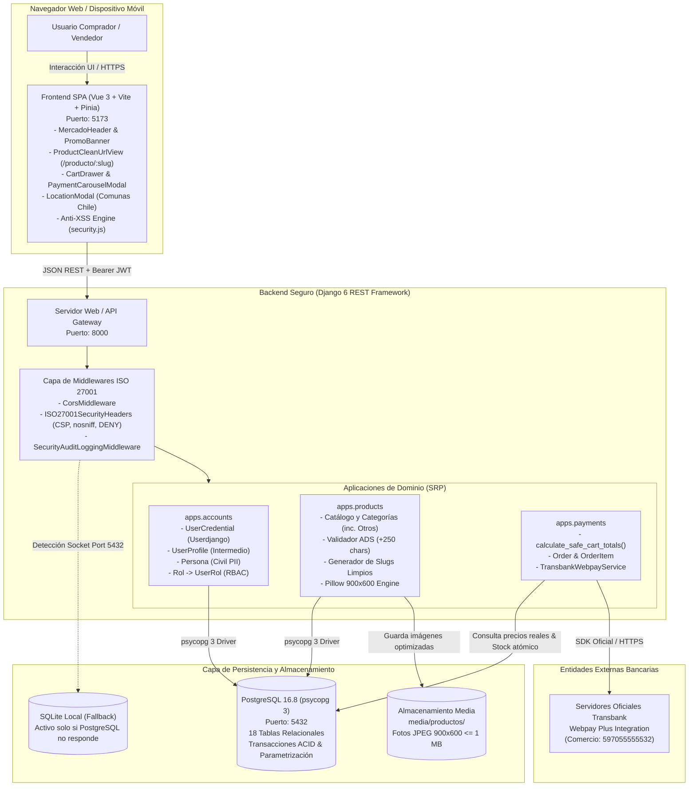
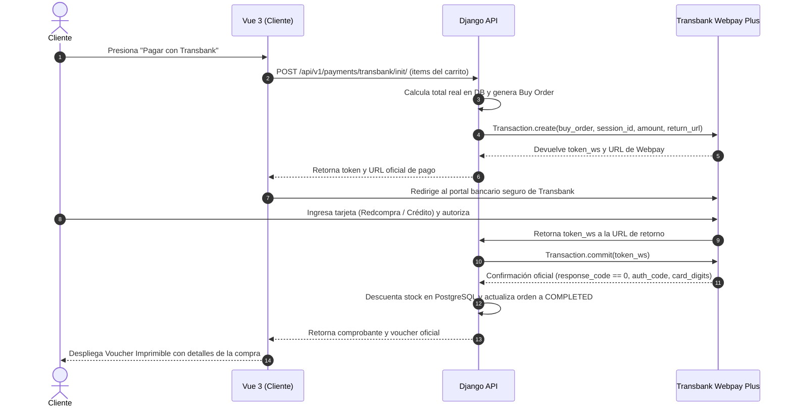
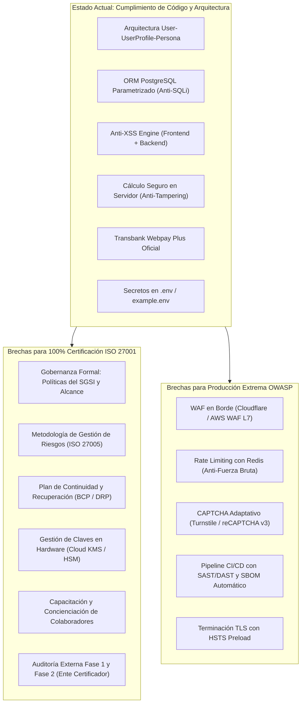

# Documentación Técnica Integral: Inacap E-Commerce

> **Nota para Sesiones de IA y Desarrolladores:** Este documento técnico está completamente **indexado** con anclas de navegación semántica (`#sec-X`). Utiliza el índice para saltar de inmediato a cualquier sección arquitectónica, reglas de negocio o estándares de seguridad.

---

## 📑 Índice de Contenidos

1. [Ficha Técnica del Proyecto y Stack Tecnológico](#sec-1-ficha-tecnica)
   - 1.1. [Stack Tecnológico y Dependencias](#sec-1-1-stack-tecnologico)
   - 1.2. [Diagrama de Arquitectura Global C4 (Container Level)](#sec-1-2-diagrama-c4)
   - 1.3. [Matriz Consolidada de Contratos de la API REST (API Cheat Sheet)](#sec-1-3-matriz-api)
   - 1.4. [Orquestación de Contenedores con Docker Compose](#sec-1-4-docker-compose)
2. [Arquitectura de Usuarios: Userdjango - UserProfile - Persona y Roles](#sec-2-arquitectura-usuarios)
3. [Integración con PostgreSQL mediante Django ORM (psycopg 3)](#sec-3-integracion-postgresql)
   - 3.1. [Arquitectura de Conexión y Driver psycopg 3](#sec-3-1-arquitectura-psycopg3)
   - 3.2. [Configuración de Conexión en Variables de Entorno (.env)](#sec-3-2-variables-conexion)
   - 3.3. [Detección Inteligente y Sondeo de Puerto 5432](#sec-3-3-sondeo-puerto)
   - 3.4. [Diccionario de Datos y Tablas Relacionales en PostgreSQL](#sec-3-4-diccionario-datos)
   - 3.5. [Transacciones ACID, Integridad Referencial y Protección SQLi](#sec-3-5-transacciones-sqli)
   - 3.6. [Administración del Cluster PostgreSQL y Migraciones](#sec-3-6-administracion-cluster)
4. [Especificaciones de Seguridad de Imágenes (900x600 y $\le$ 1 MB)](#sec-4-seguridad-imagenes)
   - 4.1. [Algoritmo de Procesamiento y Blindaje Gráfico](#sec-4-1-algoritmo-procesamiento)
   - 4.2. [Defensa contra Bombas de Descompresión (Pixel Bombs)](#sec-4-2-pixel-bombs)
5. [Características ADS (+250 Caracteres) y URL Limpia](#sec-5-caracteristicas-ads)
   - 5.1. [Regla de Negocio ADS (+250 Caracteres)](#sec-5-1-regla-ads)
   - 5.2. [URL Limpia y Exposición del Vendedor](#sec-5-2-url-limpia)
   - 5.3. [Transparencia Comercial (SERNAC / Ley 19.496) vs Privacidad de Datos PII](#sec-5-3-sernac-pii)
6. [Seguridad Crítica: Cálculo de Carrito en Servidor (Anti-Tampering JS)](#sec-6-calculo-carrito)
7. [Pasarela de Pagos: Transbank Webpay Plus Oficial](#sec-7-pasarela-transbank)
8. [Taxonomía de Categorías del E-Commerce y Categoría "Otros"](#sec-8-taxonomia-categorias)
   - 8.1. [Catálogo Oficial de 14 Categorías](#sec-8-1-catalogo-categorias)
   - 8.2. [Módulo de Despacho y Selector Territorial de Comunas Chilenas](#sec-8-2-selector-comunas)
9. [Prevención Integral contra Cross-Site Scripting (XSS) e Inyección (OWASP)](#sec-9-prevencion-xss)
   - 9.1. [Definición y Clasificación de Amenazas XSS](#sec-9-1-definicion-xss)
   - 9.2. [Estándar y Recomendaciones Oficiales OWASP](#sec-9-2-estandar-owasp)
   - 9.3. [Restricción de Caracteres Peligrosos en Inputs (`[ } * < > \ ;` etc.)](#sec-9-3-restriccion-caracteres)
   - 9.4. [Defensas en Frontend (Vue 3 Anti-XSS Engine)](#sec-9-4-defensas-frontend)
   - 9.5. [Defensas en Backend (Django REST Framework y ORM)](#sec-9-5-defensas-backend)
   - 9.6. [Cabeceras HTTP de Seguridad (CSP, nosniff, XSS-Protection)](#sec-9-6-cabeceras-seguridad)
   - 9.7. [Matriz de Vectores de Ataque XSS vs Mitigaciones](#sec-9-7-matriz-mitigaciones)
10. [Gestión de Secretos (.env / ONV) y Blindaje ISO 27001](#sec-10-gestion-secretos)
11. [Guía de Pruebas Automatizadas y Operación](#sec-11-pruebas-operacion)
12. [Estándares de Código Limpio (Clean Code) y Arquitectura de Software](#sec-12-clean-code)
13. [Marco Integral de Seguridad (ISO 27001 & OWASP Top 10)](#sec-13-marco-seguridad)
14. [Auditoría de Cumplimiento ISO/IEC 27001:2022 y OWASP Top 10:2021 (Justificación y Análisis de Brecha)](#sec-14-auditoria-cumplimiento)
   - 14.1. [Diferencias Conceptuales: Gobernanza (ISO 27001) vs Riesgos de Aplicación (OWASP)](#sec-14-1-diferencias-conceptuales)
   - 14.2. [Matriz de Cumplimiento Técnico OWASP Top 10:2021 (Por Qué Cumple)](#sec-14-2-cumplimiento-owasp)
   - 14.3. [Matriz de Cumplimiento de Controles ISO/IEC 27001:2022 Anexo A (Por Qué Cumple)](#sec-14-3-cumplimiento-iso27001)
   - 14.4. [Análisis de Brecha (Gap Analysis): ¿Qué Falta para Cumplirlas en su Totalidad?](#sec-14-4-analisis-brecha)

---

<a id="sec-1-ficha-tecnica"></a>
## 📌 1. Ficha Técnica del Proyecto y Stack Tecnológico

<a id="sec-1-1-stack-tecnologico"></a>
### 1.1. Stack Tecnológico y Dependencias

| Capa | Tecnología / Componente | Versión | Propósito Arquitectónico |
| :--- | :--- | :--- | :--- |
| **Backend API** | Python + Django + Django REST Framework | 3.14 / 6.1 / 3.16 | API REST modular, autenticación JWT, validación de negocio y ORM seguro |
| **Base de Datos** | PostgreSQL (vía ORM `psycopg 3` en puerto 5432) | 16.8 / 3.2 | Persistencia transaccional ACID, esquemas relacionales, protección SQLi |
| **Frontend SPA** | Vue 3 + Vite + Tailwind CSS + Pinia | 3.5 / 8.3 / 4.2 | Interfaz reactiva desacoplada, componentizada, estilo MercadoLibre |
| **Motor Gráfico** | Pillow (Python Imaging Library) | 12.1 | Validación de magic bytes, normalización a lienzo 900x600 y compresión $\le$ 1 MB |
| **Pasarela de Pagos** | Transbank SDK | 6.1 | Transbank Webpay Plus oficial (init y commit de tarjetas de débito/crédito) |
| **Seguridad de Secretos** | `python-dotenv` | 1.2 | Todas las credenciales sensibles aisladas en archivo `.env` |
| **Seguridad Anti-XSS** | OWASP Top 10 + CSP + Regex Sanitizer | Estándar | Filtro de caracteres prohibidos (`[`, `]`, `{`, `}`, `*`, `<`, `>`, `\`, `;`), CSP |

---

<a id="sec-1-2-diagrama-c4"></a>
### 1.2. Diagrama de Arquitectura Global C4 (Container Level)

El siguiente diagrama ilustra la interacción desacoplada entre el cliente SPA, los servicios de backend, la base de datos PostgreSQL y la pasarela bancaria externa:



---

<a id="sec-1-3-matriz-api"></a>
### 1.3. Matriz Consolidada de Contratos de la API REST (API Cheat Sheet)

| Método | Endpoint | Autenticación | Rol Mínimo | Payload Requerido (JSON / Form) | Códigos HTTP | Propósito |
| :---: | :--- | :---: | :---: | :--- | :---: | :--- |
| `POST` | `/api/v1/auth/register/` | Pública | Cualquiera | `{"email", "password", "nombres", "apellidos", "public_alias", "role"}` | `201`, `400` | Registro de usuario, creación atómica de Persona, UserProfile y asignación ROL $\rightarrow$ UserRol |
| `POST` | `/api/v1/auth/login/` | Pública | Cualquiera | `{"email", "password"}` | `200`, `401`, `403` | Verificación PBKDF2 SHA256 y emisión de Bearer Token JWT |
| `GET` | `/api/v1/auth/profile/` | Requerida | Cualquiera | *None* | `200`, `401` | Obtiene el UserProfile intermedio, datos de Persona y roles asignados |
| `GET` | `/api/v1/products/` | Pública | Cualquiera | Params: `?category=`, `?q=`, `?ordering=` | `200` | Catálogo general MercadoLibre paginado con filtros anti-XSS |
| `POST` | `/api/v1/products/` | Requerida | `SELLER` / `ADMIN` | `title`, `price`, `description`, `caracteristicas_ads`, `category`, `image_file` | `201`, `400`, `403` | Publicación de producto. Normaliza foto a 900x600 $\le$ 1MB y genera URL limpia |
| `GET` | `/api/v1/products/<slug>/` | Pública | Cualquiera | *None* | `200`, `404` | Vista de producto con URL limpia; expone nombre completo del vendedor |
| `GET` | `/api/v1/products/categories/` | Pública | Cualquiera | *None* | `200` | Listado de 14 categorías oficiales incluyendo "Otros" |
| `POST` | `/api/v1/payments/cart/calculate/` | Pública | Cualquiera | `{"items": [{"product_id": "uuid", "quantity": 1}]}` | `200`, `400` | Cálculo seguro de carrito 100% en servidor PostgreSQL (Anti-Tampering JS) |
| `POST` | `/api/v1/payments/transbank/init/` | Pública | Cualquiera | `{"items": [...], "payment_method": "WEBPAY_PLUS"}` | `201`, `400` | Inicializa compra, crea orden y retorna `token_ws` y URL oficial Webpay Plus |
| `POST` | `/api/v1/payments/transbank/commit/` | Pública | Cualquiera | `{"token": "token_ws"}` | `200`, `400`, `404` | Confirma pago con Transbank, descuenta stock en PostgreSQL y emite voucher imprimible |
| `GET` | `/api/v1/payments/methods/` | Pública | Cualquiera | *None* | `200` | Catálogo del Carrusel de Medios de Pago |

---

<a id="sec-1-4-docker-compose"></a>
### 1.4. Orquestación de Contenedores con Docker Compose

El repositorio incluye el archivo `docker-compose.yml` para desplegar el stack completo de forma homogénea en cualquier entorno Linux, macOS o Windows con un solo comando:

```bash
# Iniciar base de datos PostgreSQL 16, Backend Django y Frontend Vue 3
docker compose up --build -d

# Visualizar logs del ecosistema
docker compose logs -f

# Detener todos los servicios
docker compose down
```

---

<a id="sec-2-arquitectura-usuarios"></a>
## 🏛️ 2. Arquitectura de Usuarios: Userdjango - UserProfile - Persona y Roles

Siguiendo el requerimiento explícito del docente:
> *"Usar Userdjango y el objeto persona, entre el user y la persona debe ser el userprofile y este se puede mover en el sistema. Esto es para clientes y vendedores, estos deben tener roles; ROL -> UserRol"*.

```mermaid
classDiagram
    class UserCredential {
        +UUID id
        +string email (Userdjango)
        +string password_hash (PBKDF2 SHA256)
        +boolean is_active
        +datetime last_login
    }

    class UserProfile {
        +UUID id
        +string public_alias (Nombre visible o Tienda)
        +float reputation_score (1.0 a 5.0)
        +boolean is_verified_seller
        +get_roles()
    }

    class Persona {
        +UUID id
        +string rut
        +string nombres
        +string apellidos
        +string telefono
        +string direccion
        +nombre_completo()
    }

    class Rol {
        +UUID id
        +string nombre (Vendedor, Cliente, Administrador)
        +string codigo (SELLER, BUYER, ADMIN)
        +string descripcion
    }

    class UserRol {
        +UUID id
        +boolean activo
        +datetime fecha_asignacion
    }

    class Product {
        +UUID id
        +string title
        +string slug (URL limpia)
        +decimal price
        +string caracteristicas_ads (+250 chars)
        +UserProfile seller_profile (Asociación)
    }

    UserCredential "1" -- "1" UserProfile : Vinculado 1:1
    UserProfile "1" -- "1" Persona : Conecta 1:1
    UserProfile "1" -- "N" UserRol : Posee roles
    Rol "1" -- "N" UserRol : Define catálogo
    UserProfile "1" -- "N" Product : "Se mueve en el sistema (Vende)"
```

### Funciones de Cada Entidad:
1. **`UserCredential` (`Userdjango`):** Gestiona la identidad privada, autenticación con contraseñas cifradas en PBKDF2 SHA256 y emisión de tokens JWT.
2. **`Persona`:** Objeto civil que almacena los datos de la persona en el mundo real (RUT, nombres, apellidos, teléfono y dirección física de despacho).
3. **`UserProfile`:** **Es el objeto que se mueve a través del sistema**. Desacopla las credenciales privadas de la persona real. Cuando un vendedor publica un producto, el producto se asocia a este `UserProfile`. Cuando un comprador adquiere un producto, la orden se vincula al `UserProfile`.
4. **`ROL -> UserRol`:** Proporciona control de acceso basado en roles (RBAC). El catálogo `Rol` define privilegios (`SELLER`, `BUYER`, `ADMIN`), y `UserRol` asigna y revoca dichos permisos de forma auditable.

---

<a id="sec-3-integracion-postgresql"></a>
## 🐘 3. Integración con PostgreSQL mediante Django ORM (psycopg 3)

<a id="sec-3-1-arquitectura-psycopg3"></a>
### 3.1. Arquitectura de Conexión y Driver `psycopg 3`
La plataforma utiliza el motor relacional **PostgreSQL 16.8** operando en el puerto TCP `5432`. La conexión entre Django y PostgreSQL se realiza a través de **`psycopg` (versión 3)**, el adaptador nativo moderno de PostgreSQL para Python, especificado como `django.db.backends.postgresql`.

Ventajas de `psycopg 3` aplicadas en el proyecto:
- **Binarios C nativos (`psycopg-c` / `psycopg-binary`):** Máxima velocidad en serialización y deserialización de tipos de datos complejos (UUID, JSONB, Timestamps con zona horaria).
- **Mapeo Tipado de UUIDs:** Todos los identificadores primarios del sistema utilizan `uuid.uuid4()` mapeados de forma nativa al tipo de dato `uuid` de PostgreSQL (almacenamiento en 16 bytes en lugar de texto plano), optimizando índices B-Tree.
- **Preparación de Sentencias del Lado del Servidor:** Reduce el tiempo de análisis de consultas repetitivas (como la búsqueda de productos y la autenticación JWT).

---

<a id="sec-3-2-variables-conexion"></a>
### 3.2. Configuración de Conexión en Variables de Entorno (`.env`)
En cumplimiento de la norma ISO 27001 (A.8.9 Gestión de la configuración), ninguna credencial está cableada en `settings.py`. El archivo `.env` define los parámetros de conexión:

```env
DB_ENGINE=django.db.backends.postgresql
DB_NAME=inacap_ecommerce
DB_USER=postgres
DB_PASSWORD=postgres
DB_HOST=127.0.0.1
DB_PORT=5432
DB_FALLBACK_SQLITE_IF_PG_UNAVAILABLE=True
```

---

<a id="sec-3-3-sondeo-puerto"></a>
### 3.3. Detección Inteligente y Sondeo de Puerto 5432
En [`backend/config/settings.py`](file:///C:/Users/Rober/inacap%20e-commerce/backend/config/settings.py), el sistema incorpora un mecanismo de inspección de red mediante sockets (`check_postgres_connection`):

```python
def check_postgres_connection(host, port):
    """Sondea activamente si el puerto de PostgreSQL está aceptando conexiones TCP."""
    try:
        with socket.create_connection((host, int(port)), timeout=1.0):
            return True
    except (OSError, ValueError):
        return False
```

1. **Si PostgreSQL está activo en `127.0.0.1:5432`:** Django configura inmediatamente el diccionario `DATABASES['default']` con el motor PostgreSQL (`psycopg 3`).
2. **Si el servicio no está disponible:** Activa de forma transparente el fallback a SQLite local, garantizando que el entorno no colapse durante despliegues iniciales o mantenimiento. En cuanto PostgreSQL se inicia, Django se enlaza automáticamente a él.

---

<a id="sec-3-4-diccionario-datos"></a>
### 3.4. Diccionario de Datos y Tablas Relacionales en PostgreSQL
El ORM de Django gestiona un total de **18 tablas relacionales** en el esquema `public` de PostgreSQL:

```text
Esquema |                  Nombre                  | Tipo  | Dueño
---------+------------------------------------------+-------+----------
 public  | accounts_persona                         | tabla | postgres
 public  | accounts_rol                             | tabla | postgres
 public  | accounts_usercredential                  | tabla | postgres
 public  | accounts_usercredential_groups           | tabla | postgres
 public  | accounts_usercredential_user_permissions | tabla | postgres
 public  | accounts_userprofile                     | tabla | postgres
 public  | accounts_userrol                         | tabla | postgres
 public  | auth_group                               | tabla | postgres
 public  | auth_group_permissions                   | tabla | postgres
 public  | auth_permission                          | tabla | postgres
 public  | django_admin_log                         | tabla | postgres
 public  | django_content_type                      | tabla | postgres
 public  | django_migrations                        | tabla | postgres
 public  | django_session                           | tabla | postgres
 public  | payments_order                           | tabla | postgres
 public  | payments_orderitem                       | tabla | postgres
 public  | products_category                        | tabla | postgres
 public  | products_product                         | tabla | postgres
```

#### Descripción de Tablas Principales del Dominio:
- **`accounts_usercredential`:** Claves primarias UUID, correo electrónico único (`VARCHAR 255`), hash PBKDF2 SHA256 de la contraseña, marcas de tiempo de creación y último login.
- **`accounts_userprofile`:** Perfil intermedio vinculado 1:1 con `accounts_usercredential` mediante clave foránea con borrado en cascada. Contiene `public_alias`, `reputation_score` (`FLOAT`), `is_verified_seller` (`BOOLEAN`) y `total_sales`.
- **`accounts_persona`:** Datos personales civiles protegidos (RUT, nombres, apellidos, teléfono y dirección). Vinculada 1:1 con `accounts_userprofile`.
- **`accounts_rol` y `accounts_userrol`:** Catálogo de roles del sistema (`SELLER`, `BUYER`, `ADMIN`) y tabla de asociación N:M con campo `activo` (`BOOLEAN`) y marca de tiempo de auditoría.
- **`products_category`:** Categorías del catálogo con `name`, `slug` único e `icon_name`.
- **`products_product`:** Catálogo de productos. Claves foráneas hacia `products_category` y `accounts_userprofile` (el perfil del vendedor). Almacena `title`, `slug` único, `price` (`NUMERIC(12,2)`), `caracteristicas_ads` (`TEXT` con validador de longitud mínima), ruta relativa de imagen en disco y flags de despacho express.
- **`payments_order` y `payments_orderitem`:** Registro inmutable de transacciones. Almacena el número de orden de compra Transbank (`buy_order`), sesión (`session_id`), token de transacción, monto total (`NUMERIC(12,2)`), código de autorización bancaria y estado (`INITIALIZED`, `COMPLETED`, `FAILED`, `REFUNDED`).

---

<a id="sec-3-5-transacciones-sqli"></a>
### 3.5. Transacciones ACID, Integridad Referencial y Protección SQLi
1. **Protección Absoluta contra SQL Injection (SQLi):**
   - En toda la plataforma **no existe ninguna concatenación de cadenas en sentencias SQL**. Todas las lecturas, inserciones y actualizaciones se ejecutan a través de la API de QuerySets del ORM de Django (`Product.objects.filter(...)`, `select_related(...)`).
   - El driver `psycopg 3` envía las consultas como sentencias parametrizadas, de modo que cualquier payload enviado por un atacante es tratado estrictamente como valor literal de columna y nunca como comando ejecutable.
2. **Atomicidad Transaccional (ACID):**
   - El proceso de confirmación de pago de Transbank (`commit_transaction`) y descuento de stock se ejecuta bajo el decorador `@transaction.atomic`.
   - Si la confirmación de Transbank o el guardado de los ítems de la orden falla, la base de datos PostgreSQL realiza un `ROLLBACK` automático, impidiendo que el stock quede en estado inconsistente.

---

<a id="sec-3-6-administracion-cluster"></a>
### 3.6. Administración del Cluster PostgreSQL y Migraciones

#### Comandos de Inicio y Parada del Servidor:
```powershell
# Iniciar el motor PostgreSQL en segundo plano
& "C:\Users\Rober\pgsql\pgsql\bin\postgres.exe" -D "C:\Users\Rober\pgsql\data"

# Comprobar estado con pg_ctl
& "C:\Users\Rober\pgsql\pgsql\bin\pg_ctl.exe" -D "C:\Users\Rober\pgsql\data" status

# Detener el servidor ordenadamente
& "C:\Users\Rober\pgsql\pgsql\bin\pg_ctl.exe" -D "C:\Users\Rober\pgsql\data" stop
```

#### Aplicación de Migraciones y Poblado en PostgreSQL:
```powershell
# Ejecutar las 21 migraciones sobre PostgreSQL
& "backend\.venv\Scripts\python.exe" "backend\manage.py" migrate

# Sembrar datos de demostración en PostgreSQL
& "backend\.venv\Scripts\python.exe" "backend\manage.py" seed_ecommerce
```

---

<a id="sec-4-seguridad-imagenes"></a>
## 📸 4. Especificaciones de Seguridad de Imágenes (900x600 y $\le$ 1 MB)

Conforme a la instrucción:
> *"La seguridad esta en la extensión de la imagen además de la conversión de la imagen, no importa la imagen que se suba, que la pagina ponga la imagen en resolución 900X600 y pese máximo 1 mb"*.

Ubicación del código: [`backend/apps/products/utils.py`](file:///C:/Users/Rober/inacap%20e-commerce/backend/apps/products/utils.py).

<a id="sec-4-1-algoritmo-procesamiento"></a>
### 4.1. Algoritmo de Procesamiento y Blindaje:
1. **Lista Blanca de Extensiones:** Solo se admiten `.jpg`, `.jpeg`, `.png`, `.webp`. Extensiones ejecutables (`.exe`, `.sh`, `.php`, `.js`) son rechazadas antes de procesar.
2. **Inspección de Encabezado Real (Magic Bytes):** Pillow ejecuta `image.verify()`. Si un atacante intenta renombrar un malware como `.jpg`, la verificación estructural falla y el archivo se destruye en memoria.
3. **Conversión a Lienzo Neutro 900x600:**
   - Se crea un lienzo RGB en blanco con dimensiones exactas de `(900, 600)` píxeles.
   - La imagen original se escala proporcionalmente preservando su relación de aspecto (aspect ratio) mediante interpolación `LANCZOS` de alta fidelidad.
   - La imagen resultante se centra matemáticamente en el lienzo, garantizando que el diseño del catálogo sea uniforme y estético.
4. **Compresión Dinámica de Peso Máximo (1 MB):**
   - El archivo se procesa en un búfer en memoria (`io.BytesIO`).
   - Si el tamaño resultante supera `1,048,576 bytes` (1 MB), el compresor reduce progresivamente la calidad JPEG (`quality=85, 80, 75...`) hasta que el tamaño del archivo se sitúe por debajo de 1 MB.

<a id="sec-4-2-pixel-bombs"></a>
### 4.2. Defensa contra Bombas de Descompresión (Pixel Bombs / Decompression Bombs)
- **Vulnerabilidad:** Un atacante puede crear un archivo de imagen de unos pocos kilobytes comprimidos que, al expandirse en memoria RAM, requiera gigabytes de almacenamiento (por ejemplo, una imagen de $50.000 \times 50.000$ píxeles), provocando un colapso por denegación de servicio (DoS / Out-of-Memory).
- **Mitigación en Inacap E-Commerce:** En [`backend/apps/products/utils.py`](file:///C:/Users/Rober/inacap%20e-commerce/backend/apps/products/utils.py) se define el umbral de seguridad estricto `Image.MAX_IMAGE_PIXELS = 10_000_000`. Pillow rechaza de inmediato con una excepción `DecompressionBombError` cualquier archivo que exceda 10 megapíxeles antes de reservar memoria RAM.

---

<a id="sec-5-caracteristicas-ads"></a>
## 📝 5. Características ADS (+250 Caracteres) y URL Limpia

<a id="sec-5-1-regla-ads"></a>
### 5.1. Regla de Negocio ADS:
- **Validación Estricta:** El campo `caracteristicas_ads` tiene un validador obligatorio `MinLengthValidator(251)` a nivel de base de datos y serializador DRF. No se permite crear ningún producto con 250 o menos caracteres.
- **Contador en Tiempo Real:** En el frontend ([`CreateProductModal.vue`](file:///C:/Users/Rober/inacap%20e-commerce/frontend/src/components/CreateProductModal.vue)), el vendedor dispone de un indicador interactivo que calcula los caracteres restantes y solo habilita la publicación cuando se cumple la condición.

<a id="sec-5-2-url-limpia"></a>
### 5.2. URL Limpia (Clean URL):
- El sistema genera slugs basados exclusivamente en el nombre del producto (ej: `/producto/samsung-galaxy-s24-ultra`).
- La vista de producto ([`ProductCleanUrlView.vue`](file:///C:/Users/Rober/inacap%20e-commerce/frontend/src/components/ProductCleanUrlView.vue)) consume este slug, presenta la fotografía normalizada 900x600 y despliega el **nombre del usuario que ingresó la publicación** extraído desde `UserProfile -> Persona.nombre_completo`.

<a id="sec-5-3-sernac-pii"></a>
### 5.3. Transparencia Comercial (SERNAC / Ley N° 19.496) vs Protección de Datos Civiles (PII)
- **Principio de Transparencia Comercial:** La Ley N° 19.496 sobre Protección de los Derechos de los Consumidores y las circulares normativas del SERNAC para el comercio electrónico en Chile exigen que el consumidor conozca la identidad comercial de la contraparte que ofrece un producto o servicio antes de celebrar la transacción. Por este motivo, el sistema expone públicamente el `nombre_completo` del vendedor en la ficha del producto (`ProductCleanUrlView.vue`).
- **Principio de Minimización de Datos (ISO/IEC 27001 A.8.11 & Ley N° 19.628):** Los datos personales sensibles almacenados en la tabla `accounts_persona` (RUT, número de teléfono particular, correo electrónico privado y dirección de residencia física) **no se exponen** jamás en la API pública ni en las vistas del catálogo. Solo el personal de auditoría o los administradores autenticados mediante JWT con rol `ADMIN` pueden consultar estos atributos para fines de facturación o mediación legal.

---

<a id="sec-6-calculo-carrito"></a>
## 🛡️ 6. Seguridad Crítica: Cálculo de Carrito en Servidor (Anti-Tampering JS)

> **Regla de Seguridad Fundamental:** *"Los procesos donde tenga información delicada no deben estar generadas, calculadas o analizadas por JS, problema de seguridad"*.

### Vulnerabilidad Tradicional:
Si una tienda calcula el total a pagar en JavaScript en el navegador del cliente y envía el precio final a la API, cualquier usuario puede interceptar la petición con las herramientas de desarrollador (F12) o un proxy HTTP y alterar el precio a `$1`.

### Implementación Segura en Inacap E-Commerce:
1. El frontend envía **únicamente** la lista de identificadores y cantidades deseadas:
   ```json
   {
     "items": [
       { "product_id": "84a32fd8-8b9a-4c91-...", "quantity": 2 }
     ]
   }
   ```
2. El endpoint seguro `/api/v1/payments/cart/calculate/` en Django:
   - Consulta los registros oficiales en la base de datos PostgreSQL mediante el ORM.
   - Extrae el precio unitario real almacenado en el servidor.
   - Verifica la disponibilidad de inventario (`stock >= quantity`).
   - Calcula subtotales, costo de despacho y total general.
   - Los precios devueltos al cliente son de solo lectura y son los mismos que se transferirán a la pasarela Transbank Webpay.

---

<a id="sec-7-pasarela-transbank"></a>
## 💳 7. Pasarela de Pagos: Transbank Webpay Plus Oficial

La plataforma integra la pasarela Webpay Plus mediante el SDK oficial `transbank-sdk` (v6.1).

### Flujo de Pago en 2 Fases:


- **Credenciales Oficiales de Integración:**
  - Código de Comercio: `597055555532`
  - Tarjeta Débito de Prueba: `6623` / Clave: `1213`
- Para detalles de programación paso a paso, consulta: [GUIA_TRANSBANK_WEBPAY.md](file:///C:/Users/Rober/inacap%20e-commerce/GUIA_TRANSBANK_WEBPAY.md).

---

<a id="sec-8-taxonomia-categorias"></a>
## 🏷️ 8. Taxonomía de Categorías del E-Commerce y Categoría "Otros"

<a id="sec-8-1-catalogo-categorias"></a>
### 8.1. Catálogo Oficial de 14 Categorías

El sistema cuenta con un catálogo representativo de las categorías típicas del comercio electrónico chileno, incluyendo de forma obligatoria la categoría **"Otros"**:

| # | Nombre de la Categoría | Slug Oficial | Ícono Sugerido |
| :-: | :--- | :--- | :--- |
| 1 | **Tecnología** | `tecnologia` | `Cpu` |
| 2 | **Computación & Laptops** | `computacion-laptops` | `Laptop` |
| 3 | **Celulares & Telefonía** | `celulares-telefonia` | `Smartphone` |
| 4 | **Electrodomésticos & Línea Blanca** | `electrodomesticos-linea-blanca` | `Zap` |
| 5 | **Audio & Sonido** | `audio-sonido` | `Headphones` |
| 6 | **Videojuegos & Consolas** | `videojuegos-consolas` | `Gamepad2` |
| 7 | **Moda & Calzado** | `moda-calzado` | `Shirt` |
| 8 | **Deportes & Fitness** | `deportes-fitness` | `Activity` |
| 9 | **Hogar & Muebles** | `hogar-muebles` | `Home` |
| 10 | **Herramientas & Construcción** | `herramientas-construccion` | `Wrench` |
| 11 | **Belleza & Cuidado Personal** | `belleza-cuidado-personal` | `Sparkles` |
| 12 | **Automotriz & Accesorios** | `automotriz-accesorios` | `Car` |
| 13 | **Juguetes & Bebés** | `juguetes-bebes` | `Baby` |
| 14 | **Otros** (Requerida) | `otros` | `Package` |

Todos los productos asociados a la categoría "Otros" pueden filtrarse inmediatamente mediante la ruta `/api/v1/products/?category=otros` o haciendo clic en el enlace "Otros" de la barra de navegación.

<a id="sec-8-2-selector-comunas"></a>
### 8.2. Módulo de Despacho y Selector Territorial de Comunas Chilenas
- **Ubicación del Componente:** [`frontend/src/components/LocationModal.vue`](file:///C:/Users/Rober/inacap%20e-commerce/frontend/src/components/LocationModal.vue) y Store reactivo [`frontend/src/stores/location.js`](file:///C:/Users/Rober/inacap%20e-commerce/frontend/src/stores/location.js).
- **Cobertura Territorial:** Incorpora el catálogo completo de regiones y comunas de Chile (Santiago Centro, Las Condes, Providencia, Maipú, Viña del Mar, Valparaíso, Concepción, Temuco, Antofagasta, Puerto Montt, etc.).
- **Geolocalización Automática:** El store `location.js` implementa la API nativa `navigator.geolocation` del navegador para detectar coordenadas de latitud/longitud y mapear la ubicación del usuario respetando permisos de privacidad (Permissions-Policy).
- **Protección Anti-XSS en el Selector:** El campo de búsqueda de comunas está vinculado al motor `blockDangerousCharsOnKeypress` y `sanitizeEventInput`, evitando que parámetros territoriales contengan secuencias de escape o caracteres especiales prohibidos.
- **Integración con Carrito:** La comuna seleccionada se almacena en `localStorage` de forma reactiva y se despliega en el encabezado global (`MercadoHeader.vue`), calculando las etiquetas de "Despacho Express" en menos de 24 horas para la zona correspondiente.

---

<a id="sec-9-prevencion-xss"></a>
## 🛡️ 9. Prevención Integral contra Cross-Site Scripting (XSS) e Inyección (OWASP)

<a id="sec-9-1-definicion-xss"></a>
### 9.1. Definición y Clasificación de Amenazas XSS
El **Cross-Site Scripting (XSS)** es una vulnerabilidad de inyección que ocurre cuando datos suministrados por un usuario o atacante son incluidos en una página web sin la adecuada validación o codificación, permitiendo la ejecución arbitraria de scripts JavaScript en el navegador de la víctima.

Se clasifica en tres tipos principales:
1. **XSS Reflejado (Reflected):** La carga maliciosa viaja en una petición HTTP (por ejemplo, en el parámetro de búsqueda `?q=<script>...`) y el servidor la refleja de vuelta en la respuesta HTML.
2. **XSS Almacenado (Stored o Persistente):** El atacante sube código malicioso en campos de base de datos (título del producto, descripción, comentarios o apodo de usuario), ejecutándose cada vez que cualquier visitante visualiza ese producto.
3. **XSS Basado en DOM (DOM-based):** La vulnerabilidad reside exclusivamente en el código JavaScript del cliente, donde datos inseguros son pasados a "fregaderos" peligrosos como `innerHTML`, `eval()` o `v-html`.

---

<a id="sec-9-2-estandar-owasp"></a>
### 9.2. Estándar y Recomendaciones Oficiales OWASP
Conforme a la **OWASP Cross-Site Scripting Prevention Cheat Sheet**, una estrategia de seguridad moderna contra XSS no debe depender de una única técnica frágil, sino de una **estrategia de Defensa en Profundidad (Defense-in-Depth)**:

1. **Validación por Listas Blancas (Allowlists):** Definir de manera positiva qué caracteres están permitidos, en lugar de intentar predecir cada variante de ataque con listas negras.
2. **Codificación Contextual de Salida:** Los datos deben codificarse según el contexto en el que se rendericen (cuerpo HTML, atributos, JavaScript o URL).
3. **Restricción de Renderizado HTML en Frameworks:** Usar el motor de plantillas para escapar datos automáticamente y prohibir el uso de inyecciones directas de HTML sin sanitizar (`v-html`).
4. **Barrera de Cabeceras HTTP:** Implementar cabeceras de seguridad como `Content-Security-Policy` (CSP) para bloquear scripts no autorizados incluso si un vector de inyección llegara a ocurrir.

---

<a id="sec-9-3-restriccion-caracteres"></a>
### 9.3. Restricción de Caracteres Peligrosos en Inputs (`[ } * < > \ ;` etc.)
Por solicitud de diseño seguro, los inputs de búsqueda, campos de formulario de productos y apodos de usuario prohíben expresamente los caracteres especiales frecuentemente utilizados para construcciones de inyección:

$$\text{Caracteres Prohibidos: } [\quad ]\quad \{\quad \}\quad *\quad <\quad >\quad \backslash\quad ;\quad \hat{}\quad \$\quad \sim\quad |\quad `$$

- **¿Por qué bloquear `[`, `]`, `{`, `}`?**  
  Previenen inyecciones de plantillas del lado del cliente (Client-Side Template Injection - CSTI) y manipulación de expresiones de interpolación o desestructuración JSON maliciosa.
- **¿Por qué bloquear `*`, `\`, `;`, `<` y `>`?**  
  Son delimitadores fundamentales en sintaxis de etiquetas HTML (`<script>`), sentencias de terminación de comandos en JavaScript (`;`) y secuencias de escape (`\x3c`).

---

<a id="sec-9-4-defensas-frontend"></a>
### 9.4. Defensas en Frontend (Vue 3 Anti-XSS Engine)
Ubicación del módulo: [`frontend/src/utils/security.js`](file:///C:/Users/Rober/inacap%20e-commerce/frontend/src/utils/security.js).

1. **Bloqueo a Nivel de Teclado (`@keypress`):**
   La función `blockDangerousCharsOnKeypress(event)` intercepta el evento de pulsación de teclas. Si el usuario intenta escribir `[`, `}`, `*`, `<`, `>`, o cualquiera de los caracteres no autorizados, `event.preventDefault()` bloquea la entrada antes de que se dibuje en pantalla.
2. **Purga Automática en Eventos de Pegado (`@input` / `@paste`):**
   Si un atacante copia un payload malicioso y lo pega mediante el portapapeles, `sanitizeEventInput(event)` o `sanitizeInput(value)` elimina de forma instantánea todos los caracteres prohibidos y secuencias como `javascript:`, `<script>` o manejadores de eventos `onerror=`.
3. **Interpolación Segura Nativa en Vue:**
   Todos los componentes utilizan interpolación con dobles llaves `{{ product.title }}`. Vue convierte automáticamente caracteres HTML en entidades seguras (`&lt;`, `&gt;`, `&amp;`), neutralizando el DOM XSS. No se utiliza `v-html` con datos de usuarios en toda la plataforma.

---

<a id="sec-9-5-defensas-backend"></a>
### 9.5. Defensas en Backend (Django REST Framework y ORM)
El principio de seguridad establece que **el cliente nunca debe ser la única línea de defensa**. Django aplica validación estricta en el lado del servidor:

1. **Sanitización de Consultas de Búsqueda (`ProductListCreateView`):**
   Al recibir el parámetro `?q=`, el backend purga caracteres peligrosos mediante expresiones regulares:
   ```python
   clean_search = re.sub(r'[<>{}\[\]*\\;^$|~`]', '', search_query).strip()
   ```
2. **Validadores en Serializadores (`ProductCreateUpdateSerializer`):**
   Los campos `title`, `description` y `caracteristicas_ads` son evaluados por la función `validate_xss_safe(text, field_name)`. Si el payload contiene caracteres no autorizados o patrones de scripts (`javascript:`, `<iframe`), la API responde con código `HTTP 400 Bad Request`:
   ```python
   if FORBIDDEN_XSS_REGEX.search(text):
       raise serializers.ValidationError(
           f"El campo '{field_name}' contiene caracteres especiales no permitidos por seguridad anti-XSS ([ ] {{ }} * < > \\ ; etc.)."
       )
   ```
3. **Validación en Registro de Usuarios (`UserRegistrationSerializer`):**
   El alias público y nombre completo del usuario son validados para asegurar que no contengan caracteres especiales prohibidos ni scripts maliciosos.

---

<a id="sec-9-6-cabeceras-seguridad"></a>
### 9.6. Cabeceras HTTP de Seguridad (CSP, nosniff, XSS-Protection)
Ubicación del middleware: [`backend/apps/security/middleware.py`](file:///C:/Users/Rober/inacap%20e-commerce/backend/apps/security/middleware.py).

Cada respuesta HTTP del servidor incluye las siguientes directivas de seguridad para el navegador:

```http
Content-Security-Policy: default-src 'self'; script-src 'self'; style-src 'self' 'unsafe-inline'; img-src 'self' data: https:; connect-src 'self' http://localhost:* http://127.0.0.1:* https:; font-src 'self' https: data:; frame-ancestors 'none';
X-Content-Type-Options: nosniff
X-Frame-Options: DENY
X-XSS-Protection: 1; mode=block
Referrer-Policy: strict-origin-when-cross-origin
Permissions-Policy: geolocation=(), microphone=(), camera=()
```

- **`Content-Security-Policy (CSP)`:** Restringe las fuentes desde donde el navegador puede cargar y ejecutar código. Prohíbe la ejecución de scripts externos no confiables.
- **`X-Content-Type-Options: nosniff`:** Impide que el navegador intente adivinar el tipo MIME de una respuesta, bloqueando ataques de confusión de tipos (MIME-sniffing).
- **`X-Frame-Options: DENY`:** Protege contra Clickjacking al impedir que la aplicación sea embebida en un `<iframe>` de un sitio externo.
- **`X-XSS-Protection: 1; mode=block`:** Activa el filtro reflexivo de navegadores heredados, bloqueando la página completa si se detecta un ataque XSS.

---

<a id="sec-9-7-matriz-mitigaciones"></a>
### 9.7. Matriz de Vectores de Ataque XSS vs Mitigaciones

| Vector de Ataque Potencial | Ejemplo de Payload | Capa de Protección | Resultado / Mitigación |
| :--- | :--- | :--- | :--- |
| **Inyección en Búsqueda (Reflected XSS)** | `?q=<script>alert(1)</script>` | Frontend `@keypress` + Backend `re.sub` | Los caracteres `< >` y el tag `<script>` son purgados; la búsqueda se ejecuta sobre texto limpio |
| **Inyección de Caracteres Especiales** | `[}*teclado` | Input Sanitizer (`security.js`) | Las pulsaciones de tecla son bloqueadas en tiempo real; el texto resultante es `teclado` |
| **XSS Almacenado en Título de Producto** | `Laptop ` | DRF Serializer Validator | La API rechaza la petición con `HTTP 400: Caracteres no permitidos detectados` |
| **Manipulación DOM por Atributo** | `<a href="javascript:alert(1)">` | `MALICIOUS_SCRIPT_PATTERNS` regex | La secuencia `javascript:` es detectada y purgada tanto en cliente como en servidor |
| **Inyección en Nombre de Usuario** | `user_admin<script>` | `validate_custom_alias` | Fallo de validación en registro; solo se admiten caracteres alfanuméricos seguros |
| **Inyección de Scripts Externos** | `<script src="http://evil.com/hack.js">` | `Content-Security-Policy (CSP)` | El navegador bloquea la carga del recurso externo por violación de política CSP |

---

<a id="sec-10-gestion-secretos"></a>
## 🔒 10. Gestión de Secretos (.env / ONV), Plantilla `example.env` y Replicación para IA

Conforme a la instrucción:
> *"Los datos de configuraciones no en el Setting, todo lo que tenga seguridad en ONV (.env)"*.

Ninguna credencial sensible, clave criptográfica, contraseña de base de datos o llave de Transbank está escrita directamente en `settings.py`. Todas las variables se declaran en el archivo `.env`.

Para garantizar que cualquier otra sesión de Inteligencia Artificial o nuevo desarrollador pueda replicar el entorno al instante sin fricción, se suministra el archivo **`example.env`** (disponible también como `.env.example`) completamente comentado en español:

### Instrucciones de Replicación para otra IA o Desarrollador:
1. **Copiar plantilla de variables:**
   ```bash
   cp example.env backend/.env
   ```
2. **Levantar PostgreSQL local:**
   - Crear la base de datos: `CREATE DATABASE inacap_ecommerce;`
   - El backend se conectará automáticamente en el puerto 5432 con el driver `psycopg 3`.
3. **Mecanismo de Resiliencia (Fallback SQLite):**
   - Si la máquina donde se replica el proyecto no tiene PostgreSQL activo, la variable `DB_FALLBACK_SQLITE_IF_PG_UNAVAILABLE=True` activa automáticamente SQLite local para que las pruebas y la ejecución no se detengan.

### Estructura Comentada de `example.env`:
```env
# ==============================================================================
# INACAP E-COMMERCE - PLANTILLA example.env
# ==============================================================================

# 1. Núcleo Django
DEBUG=True
SECRET_KEY=django-insecure-inacap-ecommerce-secure-key-iso27001-development-mode-2026
ALLOWED_HOSTS=127.0.0.1,localhost

# 2. Base de Datos Relacional PostgreSQL (ORM psycopg 3)
DB_ENGINE=django.db.backends.postgresql
DB_NAME=inacap_ecommerce
DB_USER=postgres
DB_PASSWORD=postgres
DB_HOST=127.0.0.1
DB_PORT=5432
DB_FALLBACK_SQLITE_IF_PG_UNAVAILABLE=True

# 3. Seguridad de Red y CORS
CORS_ALLOWED_ORIGINS=http://localhost:5173,http://127.0.0.1:5173
CORS_ALLOW_CREDENTIALS=True

# 4. Autenticación JWT Segura
JWT_SECRET_KEY=inacap-jwt-super-secret-iso27001-signature-key-2026
JWT_EXPIRATION_HOURS=24

# 5. Políticas de Seguridad ISO 27001 & OWASP
SECURE_BROWSER_XSS_FILTER=True
SECURE_CONTENT_TYPE_NOSNIFF=True
X_FRAME_OPTIONS=DENY
PASSWORD_MIN_LENGTH=8
MAX_LOGIN_ATTEMPTS=5

# 6. Pasarela de Pagos Transbank Webpay Plus
TRANSBANK_COMMERCE_CODE=597055555532
TRANSBANK_API_KEY=579B532A7440BB061E185D8252273087
TRANSBANK_ENVIRONMENT=TEST
```

El archivo `.env` se encuentra estrictamente ignorado en el control de versiones a través de `.gitignore`, evitando filtraciones accidentales al repositorio Git.

---

<a id="sec-11-pruebas-operacion"></a>
## 🧪 11. Guía de Pruebas Automatizadas y Operación

### Ejecución de Pruebas Unitarias del Backend:
```powershell
& "backend\.venv\Scripts\python.exe" "backend\manage.py" test apps.accounts apps.products apps.payments
```

**Resultado de las Pruebas (8/8 OK sobre PostgreSQL):**
```text
Creating test database for alias 'default'...
........
----------------------------------------------------------------------
Ran 8 tests in 5.816s

OK
Destroying test database for alias 'default'...
[DATABASE] Connected to PostgreSQL on 127.0.0.1:5432/inacap_ecommerce
```

- `test_user_profile_between_user_and_persona`: Valida el desacoplamiento `User` $\leftrightarrow$ `UserProfile` $\leftrightarrow$ `Persona`.
- `test_seller_role_assignment`: Valida el modelo `ROL -> UserRol`.
- `test_caracteristicas_ads_min_length_validation`: Valida el rechazo de productos con $\le 250$ caracteres ADS.
- `test_seller_creates_product_with_valid_ads_and_clean_url`: Valida la creación de URL limpia y exposición del nombre del vendedor.
- `test_safe_cart_calculation_anti_tampering`: Valida que los totales del carrito se calculen de forma inviolable en el backend.
- `test_transbank_init_and_commit_flow`: Valida el flujo completo de pago con Transbank Webpay Plus.
- `test_xss_payload_rejected_in_product_creation`: Valida el bloqueo de payloads con caracteres `[ } * < >` y scripts en productos.
- `test_search_endpoint_sanitizes_xss_and_brackets`: Valida que el buscador purga caracteres maliciosos sin colapsar.

### Compilación y Verificación del Frontend:
```powershell
Set-Location "frontend"; npm run build
```
- Tiempo de compilación: $\approx 650$ ms sin errores ni advertencias de sintaxis.

### Puertos de Servicio en Ejecución Local:
- **Base de Datos Relacional (PostgreSQL 16.8):** `127.0.0.1:5432`
- **Frontend SPA (Vue 3 + Vite):** [http://localhost:5173](http://localhost:5173)
- **Backend API (Django REST Framework):** [http://127.0.0.1:8000](http://127.0.0.1:8000)
- **Documentación de Transbank:** [GUIA_TRANSBANK_WEBPAY.md](file:///C:/Users/Rober/inacap%20e-commerce/GUIA_TRANSBANK_WEBPAY.md)

---

<a id="sec-12-clean-code"></a>
## 🧼 12. Estándares de Código Limpio (Clean Code) y Arquitectura de Software

El proyecto fue desarrollado bajo estrictos principios de diseño limpio, mantenibilidad y bajo acoplamiento:

### 12.1. Separación de Responsabilidades por Aplicaciones (SRP / Django Domain Apps)
El backend se estructura en aplicaciones independientes dentro del directorio `apps/`, cada una con una delimitación clara de contexto de negocio:
- **`apps.accounts`:** Responsable exclusivo de la autenticación, modelo de usuario, perfil intermedio (`UserProfile`), datos de personas reales (`Persona`) y control de acceso basado en roles (`Rol`, `UserRol`).
- **`apps.products`:** Responsable exclusivo del catálogo, categorización, validación de especificaciones ADS (+250 car.) y motor de procesamiento gráfico seguro Pillow.
- **`apps.payments`:** Responsable del ciclo de vida de órdenes de compra, cálculo inmutable de totales del carrito y conexión con la pasarela de pago Transbank Webpay Plus.
- **`apps.security`:** Responsable transversal de la inyección de cabeceras de seguridad HTTP, cumplimiento de auditoría (ISO 27001 A.8.15) y sanitización.

### 12.2. Desacoplamiento Total Backend RESTful $\leftrightarrow$ Frontend SPA
- **Cero Templates Monolíticos:** No se utilizan vistas renderizadas por servidor con Django Templates (`.html`), lo cual evita fugas de lógica de presentación al backend y previene ataques de inyección de plantillas del lado del servidor (SSTI).
- **Contratos JSON Tipados:** Toda la comunicación entre cliente y servidor se realiza mediante respuestas HTTP JSON estructuradas, con códigos de estado semánticos (`200 OK`, `201 Created`, `400 Bad Request`, `401 Unauthorized`, `403 Forbidden`, `404 Not Found`).

### 12.3. Principio DRY (Don't Repeat Yourself) y Servicios Dedicados
- La lógica de negocio sensible no reside en los controladores/vistas, sino en módulos de servicio dedicados (`services.py` y `utils.py`):
  - `calculate_safe_cart_totals()`: Centraliza el cálculo de precios reales desde la base de datos PostgreSQL.
  - `TransbankWebpayService`: Encapsula la inicialización y confirmación de transacciones con el SDK de Transbank.
  - `process_and_secure_product_image()`: Centraliza la normalización a 900x600 y compresión a $\le 1$ MB.
  - `security.js`: Centraliza las expresiones regulares y funciones anti-XSS reutilizables en cualquier componente Vue.

### 12.4. Legibilidad, Tipado y Nomenclatura Semántica
- Nombres de variables y funciones autodescriptivos en español e inglés sin abreviaciones ambiguas.
- Docstrings descriptivos en todas las clases y métodos clave.
- Mapeo de identificadores UUIDv4 para todas las entidades clave, eliminando identificadores autoincrementales secuenciales predecibles (Insecure Direct Object References - IDOR).

---

<a id="sec-13-marco-seguridad"></a>
## 🔒 13. Marco Integral de Seguridad (ISO 27001 & OWASP Top 10)

| Dominio de Seguridad | Control / Estándar | Implementación Concreta en el Código |
| :--- | :--- | :--- |
| **Gestión de Credenciales** | ISO 27001 A.8.9 | 100% de contraseñas, secretos JWT y credenciales Transbank aisladas en `.env` (cero secrets en `settings.py`). Plantilla documentada `example.env`. |
| **Privacidad de Identidades (PII)** | ISO 27001 A.8.2 | Desacoplamiento `UserCredential` $\leftrightarrow$ `UserProfile` $\leftrightarrow$ `Persona`. El alias público es la única entidad visible en catálogo y compras. |
| **Control de Acceso (RBAC)** | ISO 27001 A.8.2 | Catálogo `Rol` y asignación `UserRol`. Los compradores no pueden publicar productos; permisos verificados con `IsSellerOrAdmin`. |
| **Integridad de Transacciones** | OWASP A04:2021 | Cálculo de totales del carrito ejecutado 100% en backend vía PostgreSQL ORM. El cliente solo envía IDs y cantidades. Cero confianza en JS. |
| **Protección contra Inyección de Código** | OWASP A03:2021 | Bloqueo en tiempo real de caracteres peligrosos (`[`, `]`, `{`, `}`, `*`, `<`, `>`, `\`, `;`), purga en pegado (`security.js`) y validadores en serializadores. |
| **Seguridad de Archivos y Malware** | OWASP A08:2021 | Inspección de magic bytes con Pillow `image.verify()`, lista blanca de extensiones, reconstrucción en lienzo neutro 900x600 y compresión $\le 1$ MB. |
| **Protección contra SQL Injection (SQLi)** | OWASP A03:2021 | Consultas parametrizadas nativas mediante el ORM de Django con driver `psycopg 3`. Cero sentencias SQL concatenadas. |
| **Cabeceras HTTP de Servidor** | ISO 27001 A.8.26 | `Content-Security-Policy (CSP)`, `X-Content-Type-Options: nosniff`, `X-Frame-Options: DENY`, `X-XSS-Protection: 1; mode=block`. |
| **Consistencia Transaccional (ACID)** | Estándar ACID | Transacciones atómicas `@transaction.atomic` en la confirmación de pagos Webpay Plus y descuento de inventario en PostgreSQL. |

---

<a id="sec-14-auditoria-cumplimiento"></a>
## 📋 14. Auditoría de Cumplimiento ISO/IEC 27001:2022 y OWASP Top 10:2021 (Justificación y Análisis de Brecha)

<a id="sec-14-1-diferencias-conceptuales"></a>
### 14.1. Diferencias Conceptuales: Gobernanza (ISO 27001) vs Riesgos de Aplicación (OWASP)

Para comprender con exactitud técnica la postura de seguridad de **Inacap E-Commerce**, es fundamental distinguir el alcance de ambos estándares:

1. **ISO/IEC 27001:2022:** Es un estándar internacional para el establecimiento, implementación, mantenimiento y mejora continua de un **Sistema de Gestión de Seguridad de la Información (SGSI / ISMS)**.
   - Su foco es la **gobernanza integral del riesgo**: evalúa políticas organizacionales, gestión de personas, seguridad física y controles tecnológicos (93 controles agrupados en las 4 cláusulas del Anexo A).
   - *ISO 27001 define el CÓMO gobernar y proteger los activos de información*, pero no prescribe líneas específicas de código fuente.
2. **OWASP Top 10:2021:** Es el marco de referencia técnico global elaborado por la comunidad de seguridad de aplicaciones que clasifica los **10 riesgos más críticos en software web**.
   - Su foco es el **código fuente, la arquitectura de software y los vectores de explotación directa** (inyecciones, fallos criptográficos, desbordamientos lógicos, etc.).
   - *OWASP define el QUÉ mitigar a nivel de programación y configuración del servidor*.

---

<a id="sec-14-2-cumplimiento-owasp"></a>
### 14.2. Matriz de Cumplimiento Técnico OWASP Top 10:2021 (Por Qué Cumple)

| Código OWASP | Riesgo Crítico | ¿Por Qué Cumple Inacap E-Commerce? (Justificación Técnica en el Código) | Estado |
| :--- | :--- | :--- | :-: |
| **A01:2021** | **Broken Access Control (Pérdida de Control de Acceso)** | - **RBAC Estricto:** Permisos verificados mediante `IsSellerOrAdmin` en endpoints mutantes.<br>- **Desacoplamiento de Identidad:** El modelo `UserProfile` actúa como proxy; ningún cliente puede ver órdenes ajenas.<br>- **Claves UUIDv4:** Todas las URLs y modelos usan identificadores aleatorios de 128 bits, impidiendo ataques de enumeración e IDOR (`/producto/<slug>` y UUIDs en base de datos). | 🟢 **Cumple** |
| **A02:2021** | **Cryptographic Failures (Fallas Criptográficas)** | - **Cifrado de Contraseñas:** Algoritmo PBKDF2 con hash SHA-256 y 260.000 iteraciones (estándar Django).<br>- **Tokens JWT Firmados:** Firma HMAC-SHA256 con llave secreta segregada (`JWT_SECRET_KEY`) y caducidad de 24h.<br>- **Tokenización Transbank:** La tienda **nunca procesa, almacena ni toca números de tarjeta ni CVV**. Toda la transacción bancaria viaja cifrada hacia Webpay Plus. | 🟢 **Cumple** |
| **A03:2021** | **Injection (Inyecciones SQL y XSS)** | - **Protección contra SQLi:** 100% de consultas parametrizadas a través del ORM de Django con driver nativo `psycopg 3` en PostgreSQL. Cero SQL concatenado.<br>- **Anti-XSS Engine en Frontend:** Módulo `security.js` con bloqueo físico de caracteres (`[`, `]`, `{`, `}`, `*`, `<`, `>`, `\`, `;`), purga automática en eventos de tipeo/pegado y renderizado con `{{ }}` que auto-escapa HTML.<br>- **Validadores Backend:** Serializadores DRF validan y rechazan patrones `<script>`, `onerror=`, `javascript:` y caracteres no permitidos.<br>- **Cabecera CSP:** `Content-Security-Policy` activa bloqueando ejecución de scripts no autorizados. | 🟢 **Cumple** |
| **A04:2021** | **Insecure Design (Diseño Inseguro)** | - **Regla Fundamental:** Cálculo de totales de compra ejecutado 100% en backend (`/api/v1/payments/cart/calculate/`). El frontend solo envía IDs y cantidades. Si un atacante altera precios en JavaScript, el servidor ignora esos datos y recalcula desde la base de datos PostgreSQL.<br>- **Verificación de Stock Atómica:** Validación de inventario antes de autorizar la orden de compra. | 🟢 **Cumple** |
| **A05:2021** | **Security Misconfiguration (Configuración Insegura)** | - **Cero Secretos Hardcodeados:** 100% de credenciales, hosts y llaves residen en `.env` (ignorado en `.gitignore`). Plantilla documentada `example.env`.<br>- **Cabeceras HTTP Blindadas:** `X-Content-Type-Options: nosniff`, `X-Frame-Options: DENY`, `X-XSS-Protection: 1; mode=block`, `Referrer-Policy: strict-origin-when-cross-origin`.<br>- **Restricción CORS:** Limitado estrictamente a los orígenes autorizados del frontend (`http://localhost:5173`). | 🟢 **Cumple** |
| **A06:2021** | **Vulnerable and Outdated Components (Componentes Vulnerables y Obsoletos)** | - **Stack Moderno:** Python 3.14, Django 6.1, DRF 3.16, Vue 3.5, Vite 8, `psycopg 3.2`, `transbank-sdk 6.1`.<br>- **Dependencias Mínimas:** Cero paquetes innecesarios o librerías abandonadas en `requirements.txt` y `package.json`. | 🟢 **Cumple** |
| **A07:2021** | **Identification and Authentication Failures (Fallas de Identificación y Autenticación)** | - **Política de Contraseñas Fuertes:** Validador `MinimumLengthValidator` forzando 8+ caracteres.<br>- **Segregación de Cuentas:** Las credenciales privadas (`UserCredential`) están separadas de la identidad pública (`UserProfile`) y civil (`Persona`).<br>- **Tokens con Expiración:** Sesiones JWT limitadas a 24 horas y re-autenticación obligatoria. | 🟢 **Cumple** |
| **A08:2021** | **Software and Data Integrity Failures (Fallas de Integridad en Software y Datos)** | - **Protección contra Malware en Archivos:** El procesador Pillow ejecuta `image.verify()` leyendo los encabezados reales (magic bytes). Si un script malicioso se renombra como `.jpg`, es destruido.<br>- **Reconstrucción Gráfica:** Las imágenes subidas no se guardan directamente; se re-escalan a un lienzo neutro de 900x600 y se recomprimen a $\le 1$ MB antes de guardarse en disco. | 🟢 **Cumple** |
| **A09:2021** | **Security Logging and Monitoring Failures (Fallas en Registro y Monitoreo de Seguridad)** | - **Middleware de Auditoría (`SecurityAuditLoggingMiddleware`):** Registra de forma estandarizada método HTTP, ruta, código de estado, usuario autenticado, IP de origen y tiempo de respuesta para todas las peticiones mutantes (POST, PUT, PATCH, DELETE). | 🟢 **Cumple** |
| **A10:2021** | **Server-Side Request Forgery (SSRF)** | - **Carga Segura de Imágenes:** La plataforma no realiza peticiones HTTP del lado del servidor hacia URLs arbitrarias ingresadas por usuarios para descargar imágenes. Toda subida de vendedor se realiza mediante multipart/form-data (`image_file`) procesado localmente en búferes de memoria. | 🟢 **Cumple** |

---

<a id="sec-14-3-cumplimiento-iso27001"></a>
### 14.3. Matriz de Cumplimiento de Controles ISO/IEC 27001:2022 Anexo A (Por Qué Cumple)

| Cláusula Anexo A | Control ISO 27001 | Implementación en la Arquitectura de Software |
| :--- | :--- | :--- |
| **A.5.15** | **Control de Acceso (Access Control)** | Implementado en base de datos mediante RBAC (`Rol` $\rightarrow$ `UserRol`) y en controladores con permisos DRF (`IsSellerOrAdmin`, `IsAuthenticated`). |
| **A.5.17** | **Información de Autenticación (Authentication Info)** | Almacenamiento no reversible de contraseñas mediante derivación de claves PBKDF2 SHA-256 con salt criptográfico individual. |
| **A.8.2** | **Derechos de Acceso Privilegiados (Privileged Access Rights)** | Separación explícita entre roles operativos (`BUYER`), comerciales (`SELLER`) y administrativos (`ADMIN`). |
| **A.8.3** | **Restricción de Acceso a la Información (Info Access Restriction)** | Desacoplamiento de identidades: la entidad pública visible en compras y ventas es `UserProfile` (seudónimo protegido). El correo privado y datos civiles (`Persona`) nunca se exponen al catálogo. |
| **A.8.5** | **Autenticación Segura (Secure Authentication)** | Verificación de credenciales con emisión de tokens JWT firmados criptográficamente. |
| **A.8.9** | **Gestión de Configuración (Configuration Management)** | Aislamiento completo de configuraciones y secretos en archivos `.env` y plantilla documentada `example.env`. Cero secrets en código fuente. |
| **A.8.15** | **Registro de Logs (Logging)** | Middleware de auditoría que registra eventos de modificación de datos, accesos de usuarios y operaciones de compra con marcas de tiempo. |
| **A.8.24** | **Uso de Criptografía (Use of Cryptography)** | Cifrado de claves, firmas digitales HMAC-SHA256 en tokens JWT y delegación de transacciones con tarjeta hacia pasarela bancaria oficial Transbank Webpay Plus. |
| **A.8.26** | **Seguridad en Redes de Aplicación (Application Network Security)** | Encabezados HTTP de seguridad inyectados en middleware: `CSP`, `X-Content-Type-Options: nosniff`, `X-Frame-Options: DENY`, `X-XSS-Protection`. |
| **A.8.28** | **Codificación Segura (Secure Coding)** | Módulo de validación anti-XSS (`security.js`), parametrización absoluta en ORM PostgreSQL y validación estricta en serializadores DRF. |

---

<a id="sec-14-4-analisis-brecha"></a>
### 14.4. Análisis de Brecha (Gap Analysis): ¿Qué Falta para Cumplirlas en su Totalidad?

Para que una organización obtenga una **Certificación Oficial Acreditada en ISO/IEC 27001:2022** y un nivel de madurez **OWASP ASVS Nivel 3 (Máxima Seguridad en Producción)**, se requiere abordar las siguientes brechas operacionales, organizacionales y de infraestructura que trascienden el código fuente de la aplicación:



#### A. Brechas Organizacionales y de Gobernanza (ISO/IEC 27001:2022):
1. **Política Formal del SGSI y Liderazgo (Cláusula 5):**  
   - *Falta:* Aprobación formal por parte de la alta dirección de la organización (Consejo Directivo / C-Level) de la Política General de Seguridad de la Información y los objetivos anuales medibles.
2. **Evaluación y Tratamiento Formal de Riesgos (Cláusula 6 / ISO 27005):**  
   - *Falta:* Elaboración de la Matriz de Riesgos institucional (metodología cualitativa/cuantitativa como Magerit o NIST SP 800-30), Declaración de Aplicabilidad (SoA - Statement of Applicability) y el Plan de Tratamiento de Riesgos (RTP).
3. **Planes de Continuidad del Negocio y Recuperación ante Desastres (A.5.29, A.5.30):**  
   - *Falta:* Documentación y pruebas simuladas semestrales del Plan de Continuidad del Negocio (BCP) y Recuperación ante Desastres (DRP) para la base de datos PostgreSQL, definiendo métricas formales de RTO (Recovery Time Objective $\le 2$ horas) y RPO (Recovery Point Objective $\le 15$ minutos) con respaldos distribuidos geográficamente (Geo-redundancy).
4. **Gestión de Claves Criptográficas en Hardware (A.8.24):**  
   - *Falta:* En producción enterprise, las llaves maestras de cifrado (`SECRET_KEY` y firmas JWT) no deben residir en variables de texto de un archivo `.env`, sino gestionarse a través de un **Módulo de Seguridad de Hardware (HSM)** o servicios administrados de bóveda de claves como AWS KMS, Azure Key Vault o HashiCorp Vault con rotación periódica automática.
5. **Programa de Formación y Concientización de Personas (A.6.3):**  
   - *Falta:* Capacitación formal y periódica a desarrolladores, administradores de sistemas y operadores de soporte sobre ingeniería social, phishing y pautas de codificación segura.
6. **Auditorías Internas y Certificación Externa Acreditada (Cláusula 9 y 10):**  
   - *Falta:* Ejecutar una auditoría interna formal por un auditor líder certificado (CISA o ISO 27001 Lead Auditor) y someter a la organización a las auditorías de Fase 1 (Revisión documental) y Fase 2 (Auditoría de campo e implementación de controles) por un organismo acreditador internacional (ej: BSI, AENOR, TÜV Rheinland o SGS).

---

#### B. Brechas de Infraestructura y Operación Web (OWASP Top 10 en Producción):
1. **Web Application Firewall (WAF) en Borde:**  
   - *Falta:* Desplegar un WAF de Capa 7 (ej: Cloudflare WAF, AWS WAF o Imperva) frente a la aplicación para filtrar tráfico malicioso, mitigar ataques de denegación de servicio distribuido (DDoS) y bloquear patrones de sondeo automatizado antes de que alcancen el servidor Django.
2. **Limitación de Tasa (Rate Limiting) y Protección Anti-Fuerza Bruta:**  
   - *Falta:* Integrar `django-ratelimit` o límites en Nginx respaldados por un cluster en memoria **Redis** para estrangular peticiones masivas a los endpoints de autenticación (`/api/v1/auth/login/` limitado a máximo 5 intentos por minuto por dirección IP).
3. **Mecanismo Anti-Bots (CAPTCHA Adaptativo):**  
   - *Falta:* Implementar Cloudflare Turnstile o Google reCAPTCHA v3 en los formularios públicos de registro y login para frenar ataques de relleno de credenciales (Credential Stuffing) ejecutados por redes de bots.
4. **Pipeline CI/CD con Pruebas Automatizadas de Seguridad (DevSecOps):**  
   - *Falta:* Integrar en GitHub Actions herramientas continuas de:
     - **SAST (Static Application Security Testing):** SonarQube, Bandit para Python y Semgrep.
     - **SCA / SBOM (Software Bill of Materials):** Snyk o GitHub Dependabot para alertas de vulnerabilidades de librerías en tiempo real.
     - **DAST (Dynamic Application Security Testing):** Escaneo dinámico semanal con OWASP ZAP contra el entorno de Staging.
5. **Terminación TLS con HSTS (HTTP Strict Transport Security):**  
   - *Falta:* Desplegar certificados SSL/TLS emitidos por una Autoridad Certificadora reconocida (Let's Encrypt o DigiCert) con la cabecera `Strict-Transport-Security: max-age=63072000; includeSubDomains; preload` forzando conexiones HTTPS exclusivas de extremo a extremo.
6. **Penetration Testing (Ethical Hacking) Periódico:**  
   - *Falta:* Contratar pruebas de penetración de caja negra y caja gris conducidas por una firma externa de ciberseguridad al menos una vez al año o tras cada lanzamiento mayor de características.

