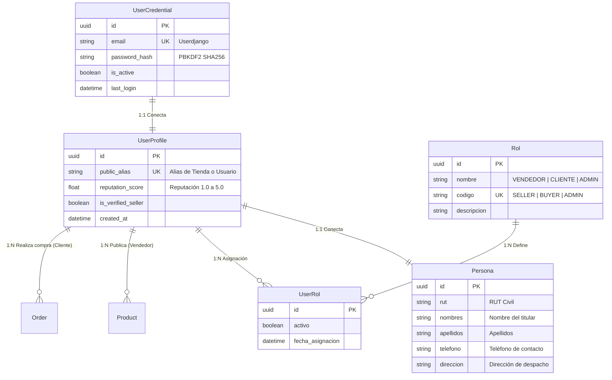

# Documentación Técnica Integral: Inacap E-Commerce

Este documento técnico reúne la arquitectura, especificaciones de ingeniería, estándares de desarrollo seguro y guías de operación de la plataforma **Inacap E-Commerce**.

---

## 📌 1. Ficha Técnica del Proyecto

| Capa | Tecnología / Componente | Propósito |
| :--- | :--- | :--- |
| **Backend** | Python 3.14 + Django 6.1 + DRF | API RESTful modular, autenticación y lógica de negocio segura |
| **Base de Datos** | PostgreSQL + Django ORM (`psycopg 3`) | Persistencia relacional, transacciones ACID y protección SQLi |
| **Frontend** | Vue 3 + Vite 8 + Tailwind CSS + Pinia | Interfaz SPA desacoplada, reactiva y amigable estilo MercadoLibre |
| **Procesamiento Gráfico** | Pillow (PIL Engine) | Normalización estricta de imágenes (900x600 y $\le$ 1 MB) |
| **Pasarela de Pagos** | Transbank SDK (`transbank-sdk` v6.1) | Pagos con tarjetas de débito (Redcompra) y crédito en Webpay Plus |
| **Gestión de Secretos** | `python-dotenv` (.env) | Aislamiento total de credenciales fuera del código fuente |

---

## 🏛️ 2. Arquitectura de Usuarios: User - UserProfile - Persona y Roles

Siguiendo el requerimiento de desacoplamiento y modelo de datos seguro:



### Funciones de Cada Entidad:
1. **`UserCredential` (Userdjango):** Gestiona la identidad privada, autenticación mediante tokens JWT y registro de sesiones.
2. **`Persona`:** Representa al individuo en el mundo real (RUT, nombre y apellidos del usuario que ingresó, teléfono y dirección).
3. **`UserProfile`:** Es el perfil intermedio que conecta `User` y `Persona`. **Este es el objeto que se mueve en el sistema**: cuando un vendedor publica un producto, el producto queda asociado a este `UserProfile`, y cuando un cliente compra, la orden se vincula al `UserProfile`.
4. **`ROL -> UserRol`:** Proporciona control de acceso basado en roles (RBAC). Permite que clientes y vendedores tengan permisos claramente diferenciados.

---

## 📸 3. Especificaciones de Seguridad de Imágenes para Vendedores

Para prevenir vulnerabilidades asociadas a la subida de archivos (como la ejecución de scripts maliciosos disguised como imágenes o saturación de disco):

1. **Lista Blanca de Extensiones Permitidas:**  
   Se validan estrictamente las extensiones `.jpg`, `.jpeg`, `.png`, `.webp`. Cualquier otra extensión es rechazada inmediatamente con error 400.
2. **Inspección de Encabezados (Magic Bytes con Pillow):**  
   El backend ejecuta `image.verify()`. Si un atacante intenta subir un archivo `.php` o script `.exe` renombrado a `.jpg`, la verificación estructural falla y el archivo se destruye.
3. **Conversión y Resolución Exacta 900x600:**  
   El procesador crea un lienzo blanco exacto de `(900, 600)` píxeles. La imagen se escala con el algoritmo de interpolación `LANCZOS` preservando su relación de aspecto original y se centra en el lienzo.
4. **Compresión Dinámica de Peso Máximo (1 MB):**  
   El archivo se comprime en un búfer en memoria (`BytesIO`). Si el tamaño inicial excede `1,048,576 bytes` (1 MB), la calidad se reduce gradualmente de forma controlada hasta situarse por debajo del megabyte antes de almacenarse en `media/productos/`.

---

## 📝 4. Características en Formato ADS (+250 caracteres) y URL Limpia

- **Regla de Negocio:** El campo `caracteristicas_ads` posee un validador obligatorio `MinLengthValidator(251)` a nivel de base de datos y serializador. No se puede crear un producto con 250 o menos caracteres.
- **URL Limpia:** El sistema genera slugs limpios basados exclusivamente en el nombre del producto (por ejemplo, `/producto/samsung-galaxy-s24-ultra`).
- **Página de Producto:** Muestra la fotografía normalizada, las características completas, la descripción y el **nombre del usuario que ingresó la publicación** extraído desde `UserProfile -> Persona.nombre_completo`.

---

## 🛡️ 5. Principio de Seguridad: Cálculo de Carrito en Servidor

> **Regla de Oro:** *"Los procesos donde tenga información delicada no deben estar generadas, calculadas o analizadas por JS"*.

En aplicaciones de comercio electrónico vulnerables, el cliente en JavaScript calcula los precios y los envía al servidor, lo que permite a un usuario alterar los valores con las herramientas de desarrollador del navegador.

En **Inacap E-Commerce**:
- El frontend envía **únicamente** los identificadores y cantidades:
  ```json
  {
    "items": [
      { "product_id": "84a32fd8-...", "quantity": 2 }
    ]
  }
  ```
- El endpoint `/api/v1/payments/cart/calculate/` consulta la base de datos PostgreSQL mediante el ORM:
  - Recupera el precio unitario oficial registrado en el servidor.
  - Comprueba que el stock actual cubra la cantidad solicitada.
  - Multiplica `precio_db * cantidad` y suma los totales.
  - El resultado devuelto es inmutable y firmado por el backend.

---

## 💳 6. Pasarela de Pagos: Transbank Webpay Plus

### Flujo de 2 Pasos:
1. **Inicialización (`/api/v1/payments/transbank/init/`):**
   - Recibe el carrito, crea la `Order` con estado `INITIALIZED` y el monto certificado.
   - Invoca `Transaction(options).create(buy_order, session_id, amount, return_url)`.
   - Transbank devuelve el token único de la transacción y la URL oficial de Webpay Plus.
2. **Confirmación (`/api/v1/payments/transbank/commit/`):**
   - El retorno de Transbank entrega el `token_ws`.
   - El servidor ejecuta `Transaction(options).commit(token)`.
   - Si `response_code == 0`, la transacción está **AUTORIZADA**:
     - Se guarda el código de autorización y últimos dígitos de la tarjeta (`**** 6623`).
     - Se descuenta el stock de los productos comprados.
     - Se emite el voucher imprimible.

### Credenciales Oficiales de Integración:
- **Código de Comercio:** `597055555532`
- **API Key:** `579B532A7440BB061E185D8252273087`
- **Tarjeta Débito (Redcompra) de Prueba:** Número `6623...`, Clave Webpay `1213`.

---

## 🔒 7. Gestión de Secretos (.env / ONV)

Ninguna clave, secreto criptográfico o contraseña de base de datos se encuentra escrita en `settings.py`. Todas las variables se declaran en el archivo `.env`:

```env
DEBUG=True
SECRET_KEY=django-insecure-inacap-ecommerce-secure-key-iso27001-development-mode
DB_ENGINE=django.db.backends.postgresql
DB_NAME=inacap_ecommerce
DB_USER=postgres
DB_PASSWORD=postgres
DB_HOST=127.0.0.1
DB_PORT=5432
JWT_SECRET_KEY=inacap-jwt-super-secret-iso27001-signature-key-2026
TRANSBANK_COMMERCE_CODE=597055555532
TRANSBANK_API_KEY=579B532A7440BB061E185D8252273087
```

El archivo `.env` está estrictamente ignorado en el repositorio `.gitignore`.
