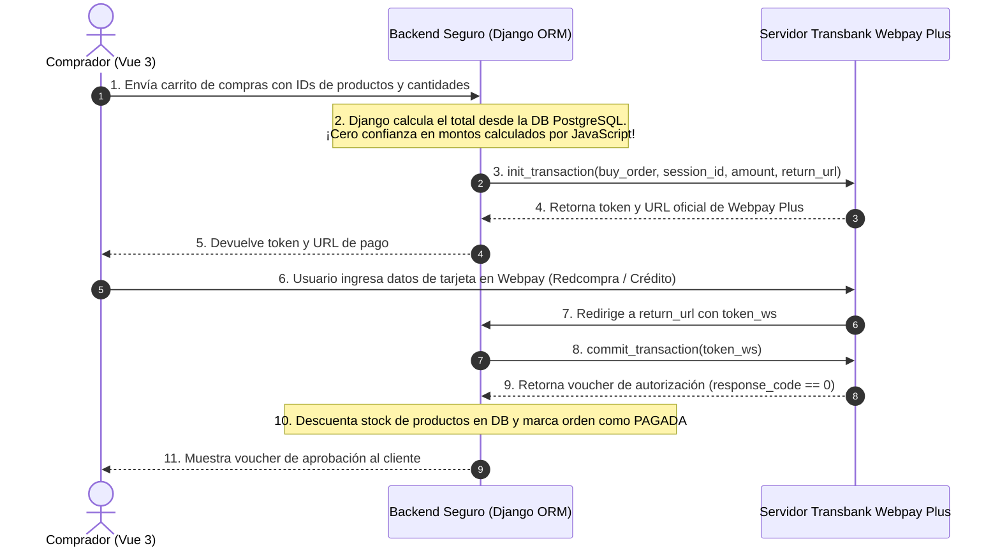

# Guía de Integración y Programación: Transbank Webpay Plus con Django y Vue 3

Esta guía detalla paso a paso cómo programar, configurar y utilizar **Transbank Webpay Plus** en un entorno de comercio electrónico moderno bajo los estándares de desarrollo seguro y **ISO/IEC 27001**.

## 1. ¿Cómo Funciona el Flujo de Pago de Transbank Webpay Plus?

El flujo consta de **4 etapas fundamentales**:



## 2. Instalación del SDK Oficial

En el entorno virtual de Django (`.venv`), se instala el SDK oficial de Transbank para Python:

```bash
pip install transbank-sdk
```

En `backend/requirements.txt`:
```text
transbank-sdk>=6.1.0
```

## 3. Configuración en Variables de Entorno (`.env`)

Por seguridad (y conforme a las directrices de configuración segura), **nunca** se colocan las credenciales en `settings.py`. Se definen en el archivo `.env`:

```env
# Transbank Webpay Plus (Credenciales Oficiales de Integración Transbank)
TRANSBANK_COMMERCE_CODE=597055555532
TRANSBANK_API_KEY=579B532A7440BB061E185D8252273087
TRANSBANK_ENVIRONMENT=TEST
```

En `backend/config/settings.py` se leen limpiamente:
```python
TRANSBANK_COMMERCE_CODE = os.getenv('TRANSBANK_COMMERCE_CODE', '597055555532')
TRANSBANK_API_KEY = os.getenv('TRANSBANK_API_KEY', '579B532A7440BB061E185D8252273087')
TRANSBANK_ENVIRONMENT = os.getenv('TRANSBANK_ENVIRONMENT', 'TEST')
```

## 4. Paso a Paso en Código (Backend Django)

### Paso 1: Cálculo Seguro del Monto (Anti-Manipulación JS)
```python
def calculate_safe_cart_totals(raw_items):
    total = Decimal('0.00')
    for item in raw_items:
        # Se obtiene el precio REAL directamente de la base de datos ORM
        product = Product.objects.get(id=item['product_id'])
        total += product.price * int(item['quantity'])
    return total
```

### Paso 2: Crear la Transacción (`init_transaction`)
```python
from transbank.webpay.webpay_plus.transaction import Transaction
from transbank.common.options import WebpayOptions
from transbank.common.integration_type import IntegrationType

# 1. Configurar opciones con credenciales de integración
options = WebpayOptions(
    commerce_code=settings.TRANSBANK_COMMERCE_CODE,
    api_key=settings.TRANSBANK_API_KEY,
    integration_type=IntegrationType.TEST
)
tx = Transaction(options)

# 2. Inicializar transacción
buy_order = f"OC-{uuid.uuid4().hex[:8].upper()}"
session_id = f"SESS-{uuid.uuid4().hex[:12]}"
amount = int(total_amount_from_db)
return_url = "http://127.0.0.1:8000/api/v1/payments/transbank/commit/"

response = tx.create(buy_order, session_id, amount, return_url)

# Retorna:
# response.token -> Token de sesión único de Webpay
# response.url -> URL oficial de pago (https://webpay3gint.transbank.cl/...)
```

### Paso 3: Confirmar la Transacción (`commit_transaction`)
Cuando Transbank finaliza la interacción con el cliente, se invoca el método `commit`:

```python
# Se entrega el token recibido
response = tx.commit(token)

# Validación de código de respuesta
if response.response_code == 0:
    # 0 = Transacción APROBADA exitosamente
    order.status = 'AUTHORIZED'
    order.authorization_code = response.authorization_code
    order.card_last_digits = response.card_detail.get('card_number')
    order.save()
    # Descontar stock en la base de datos
    descontar_stock(order)
else:
    # Transacción RECHAZADA
    order.status = 'FAILED'
    order.save()
```

## 5. Tarjetas de Prueba Oficiales de Transbank (Ambiente de Integración)

Para simular compras aprobadas en el ambiente de prueba oficial de Transbank:

| Tipo de Tarjeta | Número de Tarjeta | Fecha Expiración | CVV | Clave Webpay (Redcompra) |
| :--- | :--- | :--- | :--- | :--- |
| **Débito (Redcompra)** | `6623` (Cualquier número de 16 dígitos iniciado en 6623) | Cualquier fecha futura | Cualquiera | `1213` |
| **Crédito Visa** | `4000 0000 0000 0001` | Cualquier fecha futura | `123` | N/A |
| **Crédito Mastercard** | `5000 0000 0000 0001` | Cualquier fecha futura | `123` | N/A |

## 6. Reglas de Seguridad Críticas Exigidas

1. **Nunca calcular totales en JavaScript:** El navegador es un entorno inseguro que el usuario puede manipular con las herramientas de desarrollador (DevTools). El servidor Django debe consultar los precios en PostgreSQL y calcular el monto final de forma inmutable.
2. **Uso de `.env`:** El código de comercio y API Key deben permanecer fuera del control de versiones.
3. **Validación de Token:** Cada token de Webpay tiene un período de validez de 15 minutos; no debe ser reutilizado.
