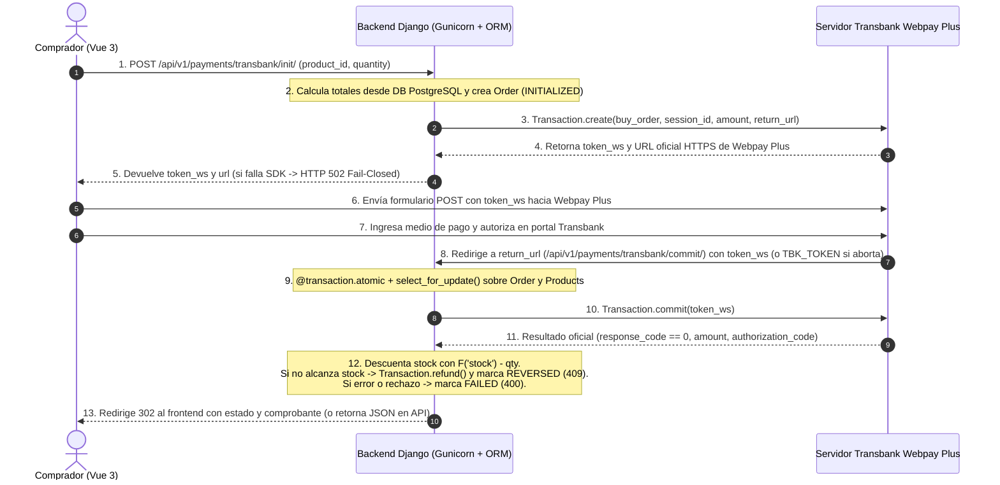

# Guía de Integración y Programación: Transbank Webpay Plus con Django y Vue 3

Esta guía detalla cómo opera la integración **Fail-Closed** de **Transbank Webpay Plus** en **Tienda Vecina** bajo estándares de desarrollo seguro e integridad transaccional **ISO/IEC 27001** y **ACID**.

## 1. Flujo Oficial de Pago de Transbank Webpay Plus

El flujo completo utiliza redirección oficial del navegador al portal bancario y confirmación atómica en servidor:



## 2. Instalación del SDK Oficial

En `backend/requirements.txt`:
```text
transbank-sdk>=6.1.0
```

## 3. Configuración en Variables de Entorno (`.env`)

Las credenciales se gestionan estrictamente fuera del código fuente mediante `.env`:

```env
# Transbank Webpay Plus
TRANSBANK_COMMERCE_CODE=597055555532
TRANSBANK_API_KEY=579B532A7440BB061E185D8252273087
TRANSBANK_ENVIRONMENT=TEST
```

En `backend/config/settings.py`:
```python
TRANSBANK_COMMERCE_CODE = os.getenv('TRANSBANK_COMMERCE_CODE', '597055555532')
TRANSBANK_API_KEY = os.getenv('TRANSBANK_API_KEY', '579B532A7440BB061E185D8252273087')
TRANSBANK_ENVIRONMENT = os.getenv('TRANSBANK_ENVIRONMENT', 'TEST')
```

El servicio `TransbankWebpayService.get_tx()` selecciona `IntegrationType.LIVE` cuando `TRANSBANK_ENVIRONMENT` es `LIVE` / `PRODUCCION` / `PRODUCTION`, e `IntegrationType.TEST` en ambiente de integración.

## 4. Implementación Segura en Backend (`backend/apps/payments/`)

### Paso 1: Cálculo Seguro del Monto (Anti-Manipulación JS)

En `backend/apps/payments/services.py`, `calculate_safe_cart_totals(raw_items)`:
- Valida tipos de entrada (`dict`, `UUID` válido, `quantity` entero $\ge 1$, rechazando booleanos, flotantes, strings o valores negativos con `ValidationError` -> HTTP `400`).
- Agrega cantidades si un mismo `product_id` aparece repetido en el arreglo.
- Obtiene el precio real e inventario directamente desde PostgreSQL mediante Django ORM.

### Paso 2: Inicialización Fail-Closed (`init_transaction`)

`TransbankWebpayService.init_transaction()` invoca `tx.create(buy_order, session_id, int(amount), return_url)`. Si el SDK no está disponible o ocurre una excepción de red/credenciales, retorna `{'status': 'ERROR'}` y `TransbankInitAPIView` responde `HTTP 502 Bad Gateway` sin emitir tokens simulados ni persistir órdenes pendientes.

### Paso 3: Confirmación Atómica, Idempotente y Reversa (`commit_transaction`)

En `TransbankCommitAPIView`:
1. Soporta tanto redirecciones de navegador (`GET` y `POST` `application/x-www-form-urlencoded` desde Webpay Plus, manejando `token_ws` o cancelación `TBK_TOKEN` / `TBK_ORDEN_COMPRA`) como llamadas `POST` JSON de la API.
2. Ejecuta dentro de `with transaction.atomic():` bloqueando la fila con `Order.objects.select_for_update().filter(transbank_token=token_ws).first()`.
3. **Protección contra Replay:** Si `order.status != 'INITIALIZED'`, rechaza la petición (`HTTP 400`) sin volver a consultar a Transbank ni descontar inventario.
4. **Bloqueo Pesimista de Inventario:** Bloquea los productos de la orden en orden determinista de `id` con `Product.objects.select_for_update()`.
5. **Confirmación Fail-Closed:** `TransbankWebpayService.commit_transaction(token_ws)` rechaza (`status: 'REJECTED'`) cualquier token inválido, prefijo simulado `tbk_token_*`, excepción de red o `response_code != 0`. También valida que el monto retornado coincida con `order.total_amount`. En fallo, marca la orden como `FAILED`.
6. **Descuento Atómico / Reversa Automática:** Actualiza stock mediante `Product.objects.filter(id=item.product_id, stock__gte=item.quantity).update(stock=F('stock') - item.quantity)`. Si el stock se agotó en concurrencia antes del commit, invoca `tbk_service.refund_transaction(token_ws, amount)`, marca la orden como `REVERSED` y responde `HTTP 409 Conflict` (o redirige con `payment_status=REVERSED`).

## 5. Tarjetas de Prueba Oficiales de Transbank (Ambiente TEST)

Para pruebas sobre el ambiente oficial de integración de Transbank (`TRANSBANK_ENVIRONMENT=TEST`):

| Tipo de Tarjeta | Número de Tarjeta | Expiración | CVV | Clave / Acción |
| :--- | :--- | :--- | :--- | :--- |
| **Débito (Redcompra)** | Tarjeta oficial de pruebas Transbank (terminada en `6623`) | Cualquier fecha futura | Cualquiera | Clave Webpay `1213` |
| **Crédito Visa** | `4000 0000 0000 0001` | Cualquier fecha futura | `123` | Según flujo portal |
| **Crédito Mastercard** | `5000 0000 0000 0001` | Cualquier fecha futura | `123` | Según flujo portal |

## 6. Reglas de Seguridad Exigidas

1. **Nunca calcular totales en JavaScript:** El cliente solo envía IDs y cantidades; el servidor calcula desde la base de datos.
2. **Principio Fail-Closed:** Ningún error de comunicación o timeout puede derivar en aprobación automática de orden.
3. **Aislamiento de Credenciales:** Código de comercio y API Key de producción deben permanecer exclusivamente en variables de entorno seguras fuera de Git.
4. **Idempotencia y Reversa:** Cada `token_ws` solo puede confirmar una orden una única vez; quiebres de stock concurrentes deben gatillar anulación/reversa inmediata.
